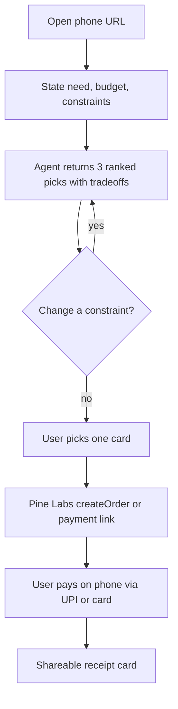
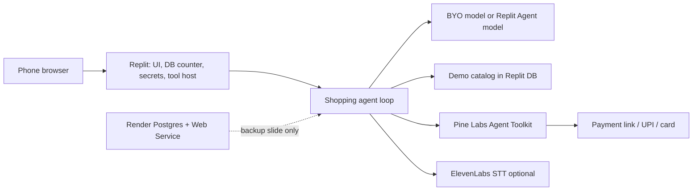

# Shopping AI assistant

**Status:** architecture draft (idea + research grounded). No build in this repo.
**Track:** Commerce.
**Boundary:** this is the broad shopping agent. Household grocery on a daily / weekly / monthly cadence is [Grocery AI](02-grocery-ai-cadences.md), a separate product that may share a checkout executor.

## One-liner

An agent that turns a budget and a constraint into three ranked buys with explicit tradeoffs, then opens a Pine Labs order the person can pay on their phone.

## Problem / who / why now

People already ask chat tools what to buy. The answer dies as a paragraph. In Bengaluru the last mile of “I would actually buy this” is UPI, and the title partner of this event is spending the keynote on an agent commerce OS. A shortlist with no payment instrument looks like a comparison blog. That is the risk called out for idea **C2 Buy-for-Me Shortlist** in the [VC map](research/builders-day-vc-research.md), and it is why the [market memo](research/builders-day-partners-and-market.md) upgrades C2 with Pine Labs checkout.

**Who, day one.** A person in the Polaris / Brookefield room with a phone, a budget, and a concrete need: earbuds for calls, a notebook, a booth merch item, a café voucher. One buyer, one session, one decision.

**Who, after Saturday.** Any shopper whose job is episodic discovery across categories — electronics, campus merch, a digital file, a stall SKU — where the hard part is tradeoffs plus a trustworthy pay step. Households restocking milk and rice are the Grocery product’s user, even when the payment rail is the same.

**Why now (India).**

- YC’s Fall 2026 requests include **agentic commerce** under the crypto/fintech section ([VC map](research/builders-day-vc-research.md)).
- Airtribe’s Commerce brief is **CONFIRM**: make buying, selling, and managing money as easy as UPI made paying.
- Pine Labs is **CONFIRM** title partner. Sanjeev Kumar’s keynote is **CONFIRM**: *“The New OS for Commerce: Building the Agent Ecosystem.”*
- Peer Capital’s public thesis includes commerce hyper-personalization ([problem archive](research/builders-day-partner-problem-statements.md), labeled **INFER** as a judge problem).
- Gaurav Mittal is a listed judge with a public career tie to Pine Labs payments technology. Confirm the badge on the day ([partner memo](research/builders-day-partners-and-market.md)).

The product sells a **decision plus a pay action**, not a conversation about shopping.

## Track and partner problem shape

| Source | What it asks | Label |
|---|---|---|
| Airtribe Commerce brief | Buying and paying as easy as UPI | **CONFIRM** |
| Pine Labs inferred card 1 — “Agent that buys, not recommends” | Ranked picks **and** a real order / payment link (sandbox allowed) | **INFER** |
| Pine Labs inferred card 4 — mandate-bounded personal shopper | One-time spend cap; agent completes inside the cap; verifiable receipt (P3P / ReservePay framing) | **INFER** |
| Pine Labs inferred card 2 — UPI micro-SKU | Natural-language order → order → pay link under ₹199 | **INFER** — stall/café mode, not the core shortlist |
| Peer Capital inferred card 3 | Research-led shopping that drives a measurable pay/hold | **INFER** |
| VC idea C2 | Budget + constraints → 3 ranked picks with tradeoffs | Research idea, not a booth card |
| VC idea C1 | Menu photo → combo + pitch | Optional stall mode |

Primary fit is Commerce. A creator selling a ₹99–₹199 file is a later mode (market memo: creator monetization gap). It is not the Saturday homepage.

## Boundary with Grocery AI

Shopping AI and Grocery AI can share Pine Labs. They do not share a planning model.

| | Shopping AI | Grocery AI |
|---|---|---|
| Job | Choose what to buy this once | Keep a household supplied on a cadence |
| Catalog | Open: earbuds, merch, a voucher, a digital file | Household replenishment: perishables, weekly cook basket, monthly staples |
| State | This session’s budget and constraints | Household, pantry memory, and a cadence of daily / weekly / monthly |
| Success | A ranked shortlist and a checkout | The right basket for that cadence, then payment |
| Repeat | A new session is a new need | The product exists because the need returns |

A grocery SKU can appear inside Shopping AI as a one-off (“atta under ₹80”). That session still has no pantry and no cadence. The recurring product is specified in [Grocery AI](02-grocery-ai-cadences.md).

## Core user flows

### Flow A — shortlist and pay (homepage)

1. User opens the Replit URL. Saturday’s host is Replit-only (D1). Render is not in front of this flow.
2. User types, or speaks via ElevenLabs if that path is on: “earbuds under ₹3,000, good for calls, over-ear is fine.”
3. Agent answers with three cards. Each card has a price band, two reasons it fits, one reason it might not, and the criterion used. No ad slot.
4. User tightens one constraint (“must work with a laptop dongle I don’t have — so Bluetooth”).
5. User chooses a card. Agent calls Pine Labs **`createOrder`** (Agent Enablement Toolkit) or returns a payment link.
6. User completes payment. Agent can **`getOrder`**. The page shows a receipt the user can forward.

### Flow B — mandate cap (stretch, same product)

**INFER** from Pine Labs card 4. User sets “₹500, next hour.” Agent may order only inside that cap. The UI shows the cap, the amount, and the receipt. If same-day P3P credentials are missing, this flow is a narrated screen in front of Flow A, not a fake claim that a mandate was enforced on a live rail.

### Flow C — stall micro-SKU (mode, not a second product)

**INFER** Pine Labs card 2 and VC idea C1. A café or booth snaps a menu or uses a preloaded Brookefield-style menu. Agent proposes a combo under ₹199 and attaches a pay link. Use this mode only if a real stall partner exists in the room. Otherwise it makes the demo feel fake (C1’s stated risk).

## Same-day demo for ~20 phones

**Goal.** Twenty people outside the team each finish a shortlist. A subset complete a sandbox pay or an explicit “hold” so the counter is about paid intent, not page views.

**Setup.**

- Public URL on **Replit**. QR on a table card.
- Curated catalog of 8–12 items with prices and criteria written by the team (earbuds, a notebook, a filter-coffee voucher, a sticker pack, a USB cable). Prices are visible and sourced as “demo catalog, 24 Oct”.
- Pine Labs **sandbox / test merchant**. Event-day credits claimed at the booth. Amounts are unpublished.
- Fallback if credentials lag: shortlist still ships; receipt UI is labeled **mock**; the speaker narrates `createOrder` / payment link and does not call it a live charge. This fallback is the recovery path in the [market memo](research/builders-day-partners-and-market.md) Bet 2. It is a weaker demo. Say so.

**Script per user (under two minutes).**

1. Scan QR, enter a name.
2. Tap a prompt chip or type a budget and a need.
3. Read three cards. Change one constraint or accept.
4. Tap **Pay / Hold**. Complete Pine Labs checkout for a small test amount (research suggests a ₹1–₹49 test SKU or an intent hold — pick one and label it).
5. Land on a receipt card. Optional: vote which pick they would buy if the payment were real delivery.

**What judges can see.** A live count of unique names, completed shortlists, and payment intents, stored in **Replit DB** (D1). **Render** Postgres is a backup slide / post-event shape only. It is not the Saturday counter.

**What the team says out loud.** “This is a sandbox order against our demo catalog. We are not shipping you earbuds from the venue.”

## Architecture sketch

**PROPOSAL** for Saturn / Gaia. Names are partner tools, not “an LLM and payments.” Saturday’s host is the accepted **D1** decision: **Replit-only**. Replit holds the UI, the DB counter, the secrets, and the tool host. **Render** Postgres and **Render** Web Service are backup / post-event only. They are not the Saturday live path. Named components and 2-coder ownership for the day: [Saturday Shopping components](08-shopping-ai-saturday-components.md).

| Piece | Tool | Role on this idea |
|---|---|---|
| Phone URL, UI, DB counter, secrets, tool host | **Replit** Agent + deploy | Saturday primary host (D1). Homepage, one-tap signup, the URL on the QR, the session counter, and the server route that holds the Pine Labs secret. The browser never sees the merchant key |
| System of record | **Replit** DB | Saturday store for users, shortlist events, and order ids. The mentor-visible count is the row count |
| Backup system of record | **Render** Postgres | Backup slide only. Post-event shape, not the Saturday live path. Free tier spins down after ~15 minutes idle — keepalive only if someone later turns Render on |
| Backup tool host | **Render** Web Service | Backup slide only. Post-event shape, not required for Saturday. Would hold the Pine Labs secret only in a later split-host shape |
| Catalog reasoner | BYO LLM (**not** an event partner) | Rank and explain. Must cite catalog fields, not invent a fourth product |
| Checkout | **Pine Labs Agent Enablement Toolkit** `@plural_pinelabs/agent-toolkit` | Tools: `createOrder`, `getOrder`, `cancelOrder`, `createRefund` ([toolkit docs](https://www.pinelabs.com/docs/online-payments/ai/agent-enablement-toolkit)) |
| Agent ops | **Pine Labs MCP server** | Natural-language payment ops from Cursor/Claude during the build. Optional at runtime |
| Stretch rail | **P3P** (HTTP 402, UPI ReservePay, cards, one-time mandates) | [P3P quickstart](https://www.pinelabs.com/docs/online-payments/ai/p3p/quickstart). Narrate if production credentials are not same-day. Do not overclaim |
| Voice input | **ElevenLabs** STT, or Conversational AI | Optional. Text must work in a loud hall |
| Telephony | **Vobiz** | Not on the critical path. A “call the stall to order” DID is a Commerce stretch (**INFER** Vobiz card 3), only after Flow A works |
| Code review | **Greptile** | Not in the user loop. Optional on the team’s own PR (“will this change break payments?” is **INFER** Greptile card 5) |
| Pitch | **Peer Capital** lens | “Agent that buys, not chat that recommends.” |
| Process | **Airtribe** brief | URL before the afternoon push; 20 users before 19:30 |

**Ranking contract (PROPOSAL).** The model may only recommend ids present in the demo catalog. Each card stores the constraint it satisfied. If nothing fits, the agent says so and asks which constraint to relax. That is the difference between a shopping agent and a model hallucinating a product page.

**Refund path.** `createRefund` / `cancelOrder` exist on the toolkit. A “refund this test order” button is a trust demo (**INFER** Pine Labs card 3) and stays off the homepage until Flow A is boringly reliable.

## Out of scope for day one

- Live delivery, returns logistics, and any promise of a physical good leaving the building.
- A general web crawl of Amazon, Flipkart, or quick-commerce apps. Prices would be uncited and the demo would look like ads.
- Grocery cadences, pantry state, and weekly meal plans. Those belong to Grocery AI.
- Production P3P settlement without dashboard credentials.
- WhatsApp as the ordering channel. Meta’s in-chat UPI work is market context in the [partner memo](research/builders-day-partners-and-market.md). WhatsApp is not an event partner.
- Multi-merchant cart, coupons, and GST invoices.
- A second product for kirana catalog cleanup (VC idea C3 / **INFER** Pine Labs card 5). That work is closer to Grocery’s vendor adapter if it is picked up later.

## Risks

| Risk | What we will be able to say |
|---|---|
| Pine Labs sandbox is slow to claim | Shortlist is real; payment UI is labeled mock; toolkit call is shown, not faked as success |
| Model invents a product or a price | Catalog allow-list; price rendered from the row, not from the completion |
| Loud hall ruins voice | Text chips are the default; ElevenLabs is additive |
| Judges hear “wrapper” | The artifact is a receipt or an honest mock receipt, plus a tradeoff the user edited |
| P3P is the keynote and also the fragile rail | Payment link is the 20-user path; P3P is a labeled stretch |

## Open questions for Saturn / Gaia

Write answers into [unified ideas → Shopping AI stub](06-unified-ideas.md).

1. Is the Saturday rail a **payment link**, Toolkit `createOrder`, or a real **P3P** mandate? Which one can be demonstrated if the booth only hands over sandbox keys at noon?
2. Where does the merchant secret live if Replit ships the UI and Render is optional — one host or two?
3. Is the demo catalog frozen, or may the agent add a row a teammate types at the booth? (Frozen is safer.)
4. Do Shopping AI and Grocery AI share one checkout service with two callers, or two copies of the toolkit wrapper?
5. Is voice on for the 20-user script, or text-only until the hall is measured?
6. What is the test amount, and what sentence does the receipt use so a user does not expect a parcel?
7. Is stall mode (Flow C) staffed by a real café, or dropped?
8. Does `createRefund` need to be in the judged demo, or is it a backup button?
