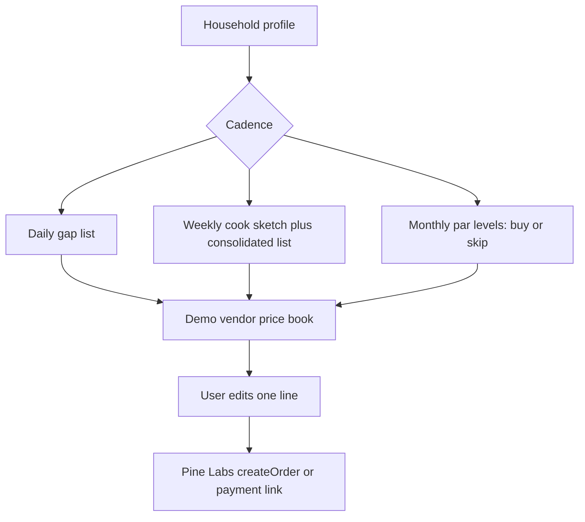
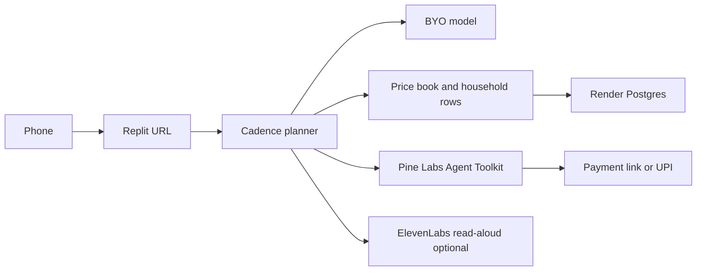

# Grocery AI — daily, weekly, monthly

**Status:** architecture draft. No build in this repo.
**Track:** Commerce, as a **recurring household vertical**. It is not a skin on [Shopping AI](01-shopping-ai.md).

## One-liner

An agent that plans a household’s groceries on the cadence the household actually buys — **daily, weekly, or monthly** — then places that basket with a vendor path and a Pine Labs payment.

## Problem / who / why now

Grocery is a repeating chore with three different clocks. Milk and coriander run out on a **daily** clock. A cook-at-home week in Bengaluru is a **weekly** basket. Rice, oil, dal, and detergent sit on a **monthly** clock because of ticket size and apartment storage. A single “what should I buy?” prompt flattens those clocks into one list and gets the quantities wrong.

**Who.** The person in a household who actually places the order. In a Brookefield flat that is often one person buying for two or more, with a cuisine pattern (veg, egg, or chicken), a budget, and a vendor they already trust — a kirana, a quick-commerce app, or a monthly staples run. The user is a planner, not a browser.

**Why now.** UPI made the pay tap easy. The planning is still a WhatsApp message, a memory, and a second app. The [market memo](research/builders-day-partners-and-market.md) calls out messy kirana catalogs and “paste SKUs → deal → collect” as a Commerce gap, and Pine Labs’ inferred card 5 is the same shape. Peer Capital’s inferred lens wants commerce that converts, not a recommendation blog. None of those sources specify daily / weekly / monthly as a product. **The cadence model is Abhinav’s portfolio direction**, written here so the vertical does not collapse into generic shopping.

Bengaluru makes the three clocks obvious: quick commerce covers the daily gap, a weekly cook plan still wants one consolidated list, and monthly staples are a different basket with a different rupee amount. Saturday’s room can feel the difference in one demo by switching cadence on the same household and watching the basket change.

## How Grocery AI differs from Shopping AI

Read this before merging the two docs in a build plan.

Shopping AI answers: **“Given a budget and a constraint, what should I buy once, and can I pay?”** The catalog is open (earbuds, merch, a voucher, a digital file). State dies with the session. Success is a ranked shortlist and a checkout. A new need starts a new session.

Grocery AI answers: **“What should this household replenish on this cadence, from which vendor, and what is the order?”** The catalog is household replenishment. State is the household, a cadence, and whatever pantry memory exists. Success is the right basket for that clock, then payment. The product is valuable on the second and tenth order, which is why cadence is the object, not a filter chip.

| Dimension | Shopping AI | Grocery AI |
|---|---|---|
| Need | Episodic discovery | Recurring supply |
| Planning object | Constraints for one decision | A cadence: daily, weekly, or monthly |
| Memory | Session | Household profile and prior baskets |
| Catalog | Cross-category demo catalog | Food and household consumables |
| Quantity logic | One unit of a chosen SKU | Packs, perishability, storage, “skip, you bought oil recently” |
| Vendor | Merchant of record for that SKU | A vendor the household returns to |
| Payment | One order | One order now; repeating mandates are the later rail |
| Failure | Hallucinated product | A monthly rice bag inside a daily list |
| Demo proof | Tradeoff card + pay | Same household, three cadences, three different baskets, then one pay |

**Shared on purpose.** Both can call the same Pine Labs checkout executor (`createOrder`, payment link). Sharing payments is not sharing a product. A one-off “buy atta under ₹80” inside Shopping AI still has no cadence and no pantry. That session stays Shopping AI.

**PROPOSAL.** Two products, one checkout service, two planning agents. Saturn / Gaia can reject the split and make Grocery a mode. The default in this portfolio is the split, because the state models diverge the moment a weekly plan exists.

## Track and partner problem shape

| Source | What it asks | Label |
|---|---|---|
| Airtribe Commerce brief | Buying and managing money as easy as UPI | **CONFIRM** |
| Pine Labs card 5 — kirana catalog → Hinglish deal → payment link | Messy SKUs become a collectable offer | **INFER** — vendor-list input, not the cadence planner |
| Pine Labs card 2 — natural-language micro-order under ₹199 | Fits a **daily** top-up (“milk, bread, eggs”) | **INFER** |
| Pine Labs card 4 — one-time spend mandate | Fits a **monthly** staple ticket with a cap | **INFER**, stretch |
| VC idea C3 — catalog doctor for kirana / D2C | Title cleanup and a deal banner | Adjacent research idea |
| Cadence model (daily / weekly / monthly) | This portfolio | **PROPOSAL** from Abhinav, not a published booth card |
| Peer Capital — outcome over chat | The artifact is the basket, not the thread | **INFER** |

Learning and Creators are not this product. A spoken read-out of today’s list can use ElevenLabs. That is a convenience layer.

## The three cadences

Cadence is an explicit choice stored on the plan. The agent may suggest a move (“oil belongs on the monthly list”) and must show that suggestion. It does not silently merge clocks.

### Daily — 12 to 36 hours

**Job.** Cover the next meal or tomorrow morning. Do not run out.

**Basket.** Small. Milk, bread, eggs, coriander, tonight’s vegetable, curd. Typically a handful of lines. High perishability, low ticket.

**Signals.** “Finished X”, “someone is coming”, “one meal.” Cuisine and household size still matter, but the horizon is tonight.

**Output.** A gap list with quantities and one substitution if the price book is missing an item. No weekly meal grid.

**Vendor.** Whoever can fulfil today: a kirana price book in the demo, later a quick-commerce slot. The demo does not call Blinkit, Zepto, Instamart, or BigBasket. Those names are the market this adapter must eventually face. They are **not** event partners, and no private API is assumed.

**Payment.** One small Pine Labs order or payment link. A standing daily mandate is post-day-one.

**Failure to avoid.** Dropping a 10 kg rice bag onto a daily list because the model “knows groceries.”

### Weekly — 7 days

**Job.** One buying run that covers how this household cooks this week.

**Basket.** Produce, dairy, breakfast, protein. Larger than daily, still not the bulk store cupboard.

**Signals.** People count, veg / egg / chicken, a cuisine pattern (“South Indian weeknights”), a weekly rupee cap, what is already in the house if the user says so.

**Output.** A short cook sketch (which meals, not a blog of recipes) and a **consolidated buy list** so coriander is purchased once. Two or three substitutions with prices from the price book. A Hinglish deal line is optional and must match the list (**INFER** Pine Labs card 5 / VC C3).

**Vendor.** One primary vendor for the run.

**Payment.** One order for that basket. Splitting produce and staples across two charges is out of scope.

**Why this is the richest Saturday artifact.** A weekly plan is visibly “the work”: meals collapsed into one list, then a pay action. It matches the “finished artifact in under two minutes” judge lens better than a chat about recipes.

### Monthly — about 30 days

**Job.** Replenish staples and household consumables before they stock out, without buying what the flat cannot store.

**Basket.** Rice, atta, oil, dal, sugar, salt, detergent, cleaners. Fewer lines, higher ticket, storage-aware.

**Signals.** Apartment storage, brand preference, last purchase if memory exists (“oil bought on the 12th → skip”).

**Output.** Par levels: buy / skip / buy a smaller pack. The skip line is the part a generic shopper cannot fake.

**Vendor.** The monthly vendor, which may differ from the daily kirana. Day one uses a second section of the same demo price book, labeled “staples.”

**Payment.** Higher ticket. A one-time mandate cap (**INFER** Pine Labs card 4, P3P / ReservePay framing) is the honest stretch. The reliable path is still one payment link.

## Core user flows

1. User opens the phone URL and picks **Daily**, **Weekly**, or **Monthly**. The choice is stored.
2. User confirms a preset or edits it: people, diet, budget, area (“Brookefield”), language for the list (English or Hinglish).
3. Agent writes the plan for **that cadence only**, citing price-book rows.
4. User changes one line (drop onions, lactose-free milk).
5. Agent restates the basket total from the price book.
6. User pays or holds via Pine Labs.
7. User can switch cadence on the same household and get a **different** basket. That switch is the product proof.

Voice: ElevenLabs can read the list back. Text remains the path if the hall is loud. Vobiz inbound (“call this number, say your weekly list”) is a stretch (**INFER**), not the homepage.

## Same-day demo for ~20 phones

Saturday **does not deliver groceries**. The artifact is a cadence plan plus a payment intent against a demo price book. Say that on the receipt.

**Setup.**

- Replit URL and a QR: “Plan my basket.”
- One household form with presets so a stranger finishes inside two minutes: “2 people, vegetarian, Brookefield, weekly cap ₹1,500.”
- A static **vendor price book** (CSV or Postgres rows) of roughly 40 items tagged `daily`, `weekly`, and/or `monthly`, with a unit price and a pack size. The team writes it. The model cannot invent prices.
- Pine Labs sandbox. If a real kirana in the venue will not fulfil, the charge is a small **basket hold** (₹1–₹49) labeled hold, or the same mock-receipt fallback as Shopping AI.
- Facilitators spread the room across cadences (about eight weekly, six daily, six monthly) so the judge sees all three clocks. The product must not require the facilitator — the cadence control is on screen.

**Per user.**

1. Name, cadence, preset.
2. Read the plan. Edit one item.
3. Pay or hold.
4. Open the other two cadences for ten seconds if they want. The counter credits a user when one plan is saved, and notes which cadence.

**Judge view.** Render Postgres (or Replit DB) count of plans by cadence, plus holds. Two saved plans for the same preset household — weekly vs monthly — on a laptop, side by side.

## Architecture sketch

**PROPOSAL.**

| Piece | Tool | Role |
|---|---|---|
| Phone URL | **Replit** | Cadence picker, plan, edit, pay button |
| Households, plans, price book, events | **Render** Postgres | Cadence is a column on the plan, not a prompt trick. Free-tier spin-down after ~15 minutes idle applies |
| Planner | BYO LLM, grounded | May only emit item ids from the price book. Must refuse to put a `monthly`-only staple on a daily plan unless the user asks |
| Vendor adapter | **PROPOSAL:** one interface, one implementation on Saturday | `quote(basket) -> lines with prices`. Implementation = demo price book. Later implementations (kirana WhatsApp list, a quick-commerce partner) are unnamed because no such partner is on the event roster |
| Checkout | **Pine Labs** `@plural_pinelabs/agent-toolkit` `createOrder`, `getOrder`; payment link as the reliable UX | Same executor Shopping AI can call. `cancelOrder` / `createRefund` for a bad hold |
| Mandate stretch | **P3P** one-time cap | Monthly basket story. Narrate if credentials slip |
| Read-aloud | **ElevenLabs** TTS | “Read my list” in English or Hinglish. Optional |
| Phone-in list | **Vobiz** DID + ElevenLabs | Stretch after the form works |
| Greptile | — | Not in this loop |
| Pitch | **Peer Capital** | “We sell the weekly basket, not a recipe chat.” Show India price and language on the list |
| Process | **Airtribe** | 20 plans from people who do not know the team |

**Grounding rule.** Every line has `price_book_id`, `cadence_tag`, `qty`, `rupees`. The total is summed in code. The model writes reasons and the cook sketch; it does not write the arithmetic.

**Memory rule, day one.** “Skip oil” works only if the user typed a last-bought note or a previous plan row exists. The agent must not invent a purchase history.

## Out of scope for day one

- Delivering food, slot selection, or live inventory from a quick-commerce API.
- Treating Grocery as a category filter inside Shopping AI.
- Recipe content, calorie apps, and nutrition claims.
- True standing instructions that charge a card every morning. Show the cadence and take one payment.
- Multi-vendor split carts.
- WhatsApp ordering. Channel context only; not an event partner.
- Image recognition of a fridge. Useful later, fatal if it is the only input on Saturday.
- Tax invoices and kirana credit ledgers.

## Risks

| Risk | Response |
|---|---|
| Judges hear “shopping agent with a green header” | Side-by-side weekly vs monthly baskets for one household, generated by the cadence field |
| Hallucinated prices | Price book allow-list; totals in code |
| No real vendor | Label the price book and the hold. Do not imply a kirana received the order |
| Daily demo feels thin | Daily stays a gap list; depth is the weekly artifact; monthly shows skip logic |
| Pine Labs credentials lag | Same mock-receipt honesty rule as Shopping AI |
| Two products, one afternoon | Grocery’s demo is self-contained. It does not require Shopping AI to be live |

## Open questions for Saturn / Gaia

1. Confirm the split: two products and one Pine Labs executor, or Grocery as a mode of Shopping AI with its own tables?
2. Which cadence is the judged homepage if there is only time to polish one — weekly is the proposal — and how are the other two still one tap away?
3. Who writes and freezes the price book, and in which unit (per piece, per kg, per pack)?
4. Is the Saturday charge a basket hold or a full sandbox total of the list?
5. Does Hinglish apply to the list, the deal banner, or both?
6. Is ElevenLabs read-aloud in the 20-user script?
7. What is the minimum household schema: people, diet, budget, locality, cadence, optional last-bought note?
8. When a real vendor exists after the event, does the adapter stay `quote()` plus a human confirming the order, or does payment wait on vendor accept?
