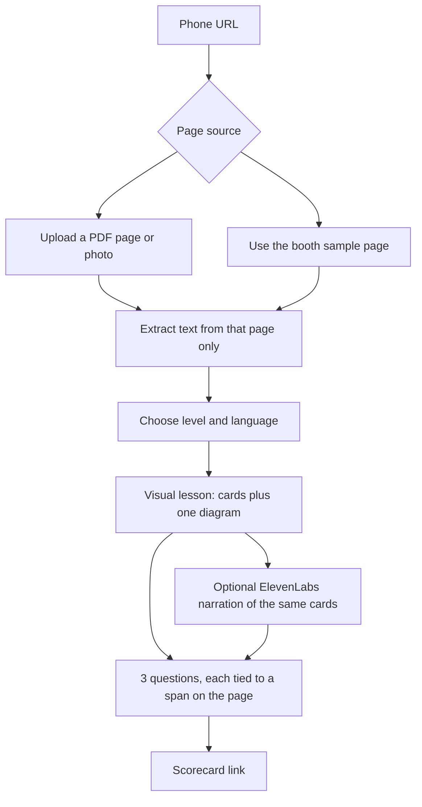
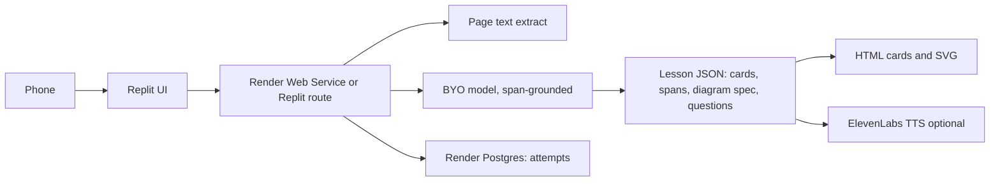

# PDF → visual learning

**Status:** architecture draft. No build in this repo.
**Track:** Learning.
**Nearest research ideas:** **L2 Concept Explainer** (syllabus page → lesson + check) and the market-memo wedge “syllabus → oral viva.” This doc commits to a **visual** lesson grounded in the upload, with voice as an optional layer.

## One-liner

Upload a syllabus page or any short PDF. Get a visual lesson — cards and a simple diagram tied to that page — and a three-question quiz that can point back at the text.

## Problem / who / why now

Students already have the material. It arrives as a PDF, a slide, or a phone photo of a page: a Polaris handout, a placement topic, a VTU-style unit. Chat tools will teach the topic from memory and drift off the page. The risk named for L2 in the [VC map](research/builders-day-vc-research.md) is exactly that: hallucinated facts when the lesson is not grounded in the upload.

A wall of spoken explanation also fails a phone in a noisy hall. The lesson has to be **lookable**: a sequence of cards, one diagram, then a check. Voice can narrate the same cards. Voice is not the lesson.

**Who.** A learner with one page they actually need this week, and a teammate who wants to compare quiz scores. On Saturday that is a builder or a Polaris student. After Saturday it is anyone whose study object is a document rather than a blank chat box — campus courses first, then job-skill notes.

**Why now.**

- YC’s Primer request and the “personal tutors” line in the [VC map](research/builders-day-vc-research.md) describe adaptive teaching at consumer scale. This product is the thin version: one page, one lesson, one check.
- Airtribe’s Learning brief is **CONFIRM**: a teacher that knows the learner, uses their language, and turns curiosity into skill.
- Lightspeed’s India notes and Peer Capital’s skilling notes, cited in the same VC map, treat language and applied learning as the wedge. The lesson can be read in English, Hindi, or Kannada while staying glued to the uploaded sentences.
- ElevenLabs is in the room for speech. The visual path still works if speech credits or hall noise fail.
- a16z “year of me” personalization is cited in the VC map as context for tutors. The personalization on day one is **level** (explain like a first exposure vs a revision) and **language**, not a psychological profile.

## Track and partner problem shape

| Source | What it asks | Label |
|---|---|---|
| Airtribe Learning brief | Teacher, own language, real skill | **CONFIRM** |
| ElevenLabs inferred card 2 — vernacular explainer | One PDF page taught aloud in Hindi or Kannada with 3 check questions | **INFER** — we keep the 3 questions and add a visual lesson the ear can also follow |
| Market memo — syllabus → oral viva | Upload → 90s oral + 3 checks | Research wedge; oral is the ElevenLabs mode of this product |
| VC idea L2 | Paste syllabus; teach at level; 3-question check | Research idea |
| Peer Capital inferred card 4 — skilling with an accountability loop | A visible outcome (score, next drill) | **INFER** — the scorecard is that outcome |
| Pine Labs | Paid drill packs are a secondary Commerce angle in the Pine Labs track map | **INFER**, and **out of scope** for day one |

This idea does not answer the Commerce keynote. Do not bolt a paywall onto the quiz for the 20-user pass.

## Core user flows

1. Learner opens the URL and either uploads one page or taps **Use today’s page** (a page the team printed and also hosts, so the queue still moves when upload fails).
2. Extractor keeps text from that page. If extraction is empty, stop and ask for a clearer photo. Do not “teach the topic anyway.”
3. Learner picks level (first look / revision) and language (English / Hindi / Kannada).
4. Agent returns a visual lesson:
   - four to six short cards (idea, analogy, worked step, watch-out),
   - one diagram rendered as structured HTML/SVG from a small JSON spec (boxes and arrows the page implies),
   - a line under each card: the phrase on the page it came from.
5. Optional: **ElevenLabs** TTS reads the cards in the chosen language. The diagram stays on screen.
6. Three questions. Each question stores the source span. The scorecard shows right/wrong and the span, so a dispute is checkable.
7. Share link: score, page title, language. Teammates can retry the same page.

**Grounding contract (PROPOSAL).** A card or question without a span from the extract is a bug, not a style choice. If the page does not support a diagram, ship cards only and say “this page did not describe a structure to draw.”

## Same-day demo for ~20 phones

**Setup.**

- Replit URL. QR on a table. One **sample page** printed beside the QR (a single topic that fits on a phone: for example a definition-plus-example the team has rights to use — a short original note, not a scanned copyrighted textbook).
- Upload button for people who bring their own one-pager.
- Render Postgres rows: attempt id, language, score, spans. Live counter “attempts today.”
- ElevenLabs credits claimed at the booth. Narration is a toggle defaulting to **off** in the scripted path so a slow TTS call cannot block the quiz. Turn it on for judges and for anyone who asks.

**Script (about 90 seconds).**

1. Scan, name, tap the sample page (or upload).
2. Leave language on English unless the user picks Hindi or Kannada.
3. Swipe the cards. Look at the diagram.
4. Answer three questions.
5. Show the scorecard. Optional share.

**Room proof.** Twenty scorecards. At least a few people on their own upload if the extractor survives phone photos. A laptop view of the counter.

**What we claim.** “The questions are written from this page, and you can see the line they came from.” We do not claim a full tutor, a course, or exam prediction.

## Architecture sketch

**PROPOSAL.**

| Piece | Tool | Role |
|---|---|---|
| Phone URL | **Replit** | Upload, cards, quiz, scorecard |
| Attempts and extracts | **Render** Postgres | Judge-visible counter; free-tier idle spin-down still applies |
| Extract | Code, not the chat model | PDF text or a single-page OCR path. If OCR quality is poor, the sample page still runs |
| Teacher | BYO LLM | Returns JSON only. Copy spans from the extract. No web search |
| Diagram | HTML/SVG from the JSON spec | Avoids an image-generation API. No image model is an event partner |
| Narration | **ElevenLabs** TTS | Same card text, chosen language. STT is unnecessary for the quiz (taps). Conversational AI is the oral-viva stretch, not the homepage |
| Oral viva stretch | **ElevenLabs** Conversational AI, then **Vobiz** if a real call is required | Matches **INFER** ElevenLabs card 2 and the market memo’s viva. Ship after cards and quiz are solid |
| Payments | **Pine Labs** | Not in the day-one loop |
| Greptile | — | Not in the loop |
| Pitch | **Peer Capital** / Learning brief | “A lesson from your page, with a score you can show.” Language is the India-specific knob |
| Process | **Airtribe** | Twenty learners, shareable scores |

**Level knob.** “First look” uses shorter cards and easier checks. “Revision” skips the analogy and asks a harder application question that still cites the page. Both stay inside the extract.

**Language knob.** The span on the page may be English while the card is Hindi or Kannada. The scorecard shows both: the teaching sentence and the source span. Translation quality is an open risk; the span lets the user audit it.

## Out of scope for day one

- A multi-page course, spaced repetition over weeks, or a parent SMS loop (those are separate market-memo wedges).
- Camera-based vocational coaching (VC idea L5). Vision-plus-checklist will not be robust in five hours.
- Interview roleplay. That is backlog **L1**, which wants a voice agent as the homepage. This product’s homepage is the page.
- Generated bitmap illustrations and stock photos.
- Grading handwritten answers.
- Payments for “premium drills.”
- Teaching from a topic name with no document. Empty upload does not fall through to a generic lecture.
- Copyrighted textbooks pasted in full. The booth sample is a page the team can show. Users upload their own single page at their own responsibility; the demo stores the extract for the attempt, not a library.

## Risks

| Risk | Response |
|---|---|
| Hallucinated lesson (L2’s main risk) | Span required per card and question; refuse if extraction fails |
| Phone photo OCR is messy | Sample page is the scripted path; upload is best-effort |
| “Just ChatGPT with cards” | Cards cite lines; quiz is scored; counter is real attempts |
| Kannada or Hindi TTS sounds wrong | Visual lesson stands alone; narration is optional |
| Diagram JSON is nonsense | Validator: only a small allow-list of nodes and edges; otherwise cards only |
| Loud hall | Quiz is taps, not speech |

## Open questions for Saturn / Gaia

1. Is the diagram spec worth it on Saturday, or are citation cards enough and SVG waits?
2. Where does extraction run — Replit, Render, or the browser — and what is the max file size?
3. Do we store the PDF, or only the text of the attempt? Retention after the event?
4. Which language ships in the 20-user script, and who checks Hindi and Kannada strings before doors open?
5. Is the oral viva (ElevenLabs Conversational AI, Vobiz as stretch) a second screen or explicitly later?
6. What is the booth sample page, and do we have the right to print it?
7. Scorecard: show correct answers immediately, or only the span and a score?
8. Does “level” change the prompt only, or do we need two frozen prompt templates checked against the sample page?
