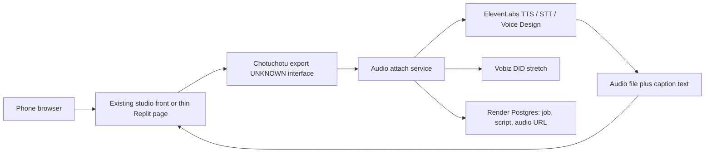

# Chotuchotu studio

**Status:** architecture draft for the **audio gap**. The studio itself already exists in a private repo. This documentation repo cannot see that code, so studio internals stay **UNKNOWN** until Saturn / Gaia read them.
**Track:** Creators.
**Working name from Abhinav:** private-repo video studio, “checkout autoshort.”

## One-liner

Keep the existing Chotuchotu video studio. Add the missing audio layer with ElevenLabs so a short leaves the phone with a voice (and, as a stretch, a real phone-in take via Vobiz).

## What is known vs unknown

| | Status | Source |
|---|---|---|
| A private video studio called Chotuchotu exists | Known as a product fact for this portfolio | Abhinav’s brief for this repo |
| Working name “checkout autoshort” | Known as the name he used | Same brief. Whether that string is a repo, a branch, a button, or a feature flag is **UNKNOWN** |
| Audio integration is not set up | Known gap | Same brief |
| Exact pipeline (ingest, cut, captions, storage, deploy target, models) | **UNKNOWN** | Not in the research archive; repo not mounted here |
| Event partners for speech | **CONFIRM** roster | ElevenLabs toolkit; Vobiz toolkit ([partner memo](research/builders-day-partners-and-market.md)) |

Do not invent modules, file formats, or a claim that the studio already cuts three Reels. The Saturday job is to **attach audio to whatever the studio can already export**, after someone opens the private repo and writes the real interface into the stub in [unified ideas](06-unified-ideas.md).

## Problem / who / why now

The Creators brief (**CONFIRM**) is a full studio in one phone, in any Indian language. A video tool that exports a silent or music-only cut still leaves the creator in another app to record a voiceover, then in a third app to line it up. That is the gap Abhinav named: the studio is real, the audio path is not.

**Who.** A creator who already has footage — a booth clip, a class explainer, a product demo — and needs a voice track and captions more than they need another editor. On Saturday the user is someone in the room willing to record 20–40 seconds or to use a consented sample.

**Why now.**

- a16z’s agentic-video note and Peer Capital’s entertainment/creator notes are the demand context in the [VC map](research/builders-day-vc-research.md) and the [market memo](research/builders-day-partners-and-market.md). Idea **CR1 Clip Autopilot** (long video → vertical shorts with captions) is the greenfield shape of this job. Chotuchotu is the asset that should absorb that shape, not a second editor built from zero in the hackathon.
- ElevenLabs inferred cards 3 and 5 — voiceover plus captions, and English script → Hindi/Hinglish voiceover — match the missing layer (**INFER**, [problem archive](research/builders-day-partner-problem-statements.md)).
- Vobiz’s published hint for this event is soft: explore products that can speak, call, and interact. Numbered problems are still **INFER**. A DID is a stretch on top of browser upload, not the first audio path.
- India language is the track brief. ElevenLabs TTS is how a Hinglish or Hindi line becomes an actual file the studio can hold.

CR1 remains on the [backlog](07-backlog-demos.md) as the from-scratch demo if the private studio cannot be deployed at the venue. The portfolio preference is to extend Chotuchotu.

## Track and partner problem shape

| Source | What it asks | Label |
|---|---|---|
| Airtribe Creators brief | Full studio in one phone, any Indian language | **CONFIRM** |
| ElevenLabs card 3 — studio VO | Voice Design or clone → 30–60s VO + captions the user can post | **INFER** |
| ElevenLabs card 5 — dub lite | English script → Hindi/Hinglish VO + timed captions | **INFER** |
| Vobiz card 4 — browser, then PSTN | Ship the browser path; show a real number as the stretch | **INFER** |
| VC idea CR1 | Find hooks, cut vertical shorts, captions | Research shape for what “autoshort” should demonstrate once the repo is read |
| Pine Labs creator ₹99–₹199 pay link | Monetise a finished file | **INFER**, out of scope until audio export works |
| Replit “voice app that ships” | Deploy an app that speaks | **INFER** — only if the studio itself is not already hosted |

## Core user flows

The middle box is deliberately unspecified.

```mermaid
flowchart TD
  footage[Footage or studio project] --> studio[Chotuchotu studio export]
  studio --> gap[Audio gap today]
  gap --> path{Audio path}
  path --> tts[ElevenLabs TTS or Voice Design from a script]
  path --> stt[ElevenLabs STT if a scratch voice exists and needs a transcript]
  path --> call[Vobiz stretch: creator calls a DID and leaves the take]
  tts --> attach[Attach VO and caption file to the export]
  stt --> attach
  call --> attach
  attach --> share[Phone share: video or audio card]
```

**PROPOSAL — day-one path, to be checked against the repo.**

1. Creator opens a phone URL (existing studio URL, or a thin Replit page in front of it).
2. Creator provides a short the studio can already produce, **or** uploads a short clip if “export” is a file.
3. Creator types one or two lines of script, or accepts a script drafted from a transcript.
4. **ElevenLabs** synthesizes the voice. Default voice is a premade voice. Voice Design / clone is a labeled stretch (consent and time).
5. The page returns the audio file plus a plain caption file (lines and rough timings). Muxing audio into the video is in scope only if the studio already has a place to drop an audio track. If it does not, the share artifact is **video export + audio file side by side**, and the team says that.
6. Stretch: a **Vobiz** India number. The creator calls, speaks the line, hangs up. That recording replaces TTS. ElevenLabs STT can turn it into captions. SIP integration notes: [Vobiz × ElevenLabs](https://www.vobiz.ai/docs/integrations/elevenlabs).

**Language.** Script language is an explicit field: English, Hinglish, Hindi. The voice must match the script language or the UI must say it could not.

## Same-day demo for ~20 phones

This demo depends on a fact this repo does not have: can Chotuchotu run on a network the room can reach?

**If the studio is reachable.**

- QR to the audio step, not to a blank editor.
- A 20–40s consented sample clip already exported, so nobody waits on a long render to feel the loop.
- Users who want to can record their own short clip on the phone **only if** the studio already accepts that upload. Otherwise they use the sample and write their own script line — the personal artifact is the voice.
- ElevenLabs returns audio in well under a minute for a two-line script.
- Count unique audio renders. Target 20. A laptop plays three of them.

**If the studio is not deployable at Polaris.**

- Do not rebuild Chotuchotu on Saturday.
- Run the audio step on a Replit URL against the sample clip, and say “this is the audio module the studio does not have yet.”
- CR1 from-scratch cutting is the backlog alternative only if the team explicitly pivots. It is not the silent default.

**What we claim.** “The studio could already make the picture. This is the voice layer, on ElevenLabs, in the language of the script.” We do not claim a full editor, a clone of the user’s voice, or a posted Reel unless the file actually plays.

## Architecture sketch

**PROPOSAL**, with an explicit hole where the private repo sits.



| Piece | Tool | Role |
|---|---|---|
| Studio | Chotuchotu private repo | Picture pipeline. Interface **UNKNOWN**: export URL, file upload, or internal API. First architecture task is to name that interface |
| Thin front, only if needed | **Replit** | Phone URL for script → audio when the studio has no public page for this step |
| Job log | **Render** Postgres | script, language, voice id, audio URL, user. Proves 20 renders |
| Voice | **ElevenLabs** TTS | Required path. Event-day credits plus the public free tier (10k credits/month) noted in the partner memo |
| Transcript | **ElevenLabs** STT | Only if the input is a human take or an existing scratch track |
| Character voice | **ElevenLabs** Voice Design / clone | Stretch. Consent copy on screen. Easy to burn the clock |
| Phone-in take | **Vobiz** SIP / India DID in front of ElevenLabs | Stretch. New accounts get ₹25; event credits via tagged claim links are the pattern in the partner memo, amounts for this event unpublished. WebRTC/browser remains the path that must work |
| Captions | Caption text from the script, or STT timestamps | Burned-in captions require a video mux. **UNKNOWN** whether the studio has one. Side-by-side file is the acceptable day-one artifact |
| Payments | **Pine Labs** | Not required to prove audio. A “pay ₹99 to download” link is a later creator-desk idea from the market memo |
| Greptile | — | Not in the creator loop |
| Pitch | **Peer Capital** + Creators brief | “A studio that finishes the voice, in an Indian language, on one phone URL.” |
| Process | **Airtribe** | 20 people leave with an audio file they can play |

**Build rule.** The audio service takes `(media_ref, script, language) → (audio_url, caption_text)`. It does not reimplement cutting, hook detection, or thumbnails. Those stay inside Chotuchotu or they stay unbuilt this weekend.

## Out of scope for day one

- Rewriting the video studio on Replit.
- Assuming ffmpeg, a timeline UI, or multi-cam — none of that is verified.
- Voice cloning of attendees without a clear consent step. Default is a premade ElevenLabs voice.
- Full dub of a long talk. Cap the script.
- Automatic posting to Instagram or WhatsApp Status.
- Pine Labs unlock-after-pay.
- Vobiz as a dependency of the judged demo.
- Music licensing and stock footage.

## Risks

| Risk | Response |
|---|---|
| Private repo is inaccessible at the venue | Audio module on a sample file; do not pretend the studio ran |
| “Checkout autoshort” means something narrower than a full editor | Document the real meaning in the Saturn / Gaia stub before wiring |
| Render time of video blows the two-minute artifact | Pre-exported sample; the timed demo is the voice |
| ElevenLabs voice language mismatches the script | Language field is explicit; fail visibly |
| Vobiz DID setup eats the afternoon | Browser TTS first, matching the partner memo’s “web voice first” guidance |
| CR1 and Chotuchotu both get built halfway | One path. Extending the studio wins unless it cannot boot |

## Open questions for Saturn / Gaia

1. Repo URL, default branch, and how a teammate runs it. What does the string “checkout autoshort” refer to in that repo?
2. What can the studio export today: file, link, timeline JSON, silent MP4, captionless verticals?
3. Is there already a slot for an audio track, or is the integration a new upload beside the video?
4. Where is it hosted now, and can a phone on venue Wi-Fi reach it? If not, is a thin Replit audio page acceptable for Saturday?
5. Premade ElevenLabs voice ids for English, Hindi, and Hinglish — who picks them, and are they licensed for a room full of strangers?
6. Is Vobiz in the Saturday script at all, or only a diagram?
7. Caption burn-in: studio feature, or explicitly side-by-side files?
8. Consent and retention: whose face is in the sample clip, and do we delete uploads after the demo?
