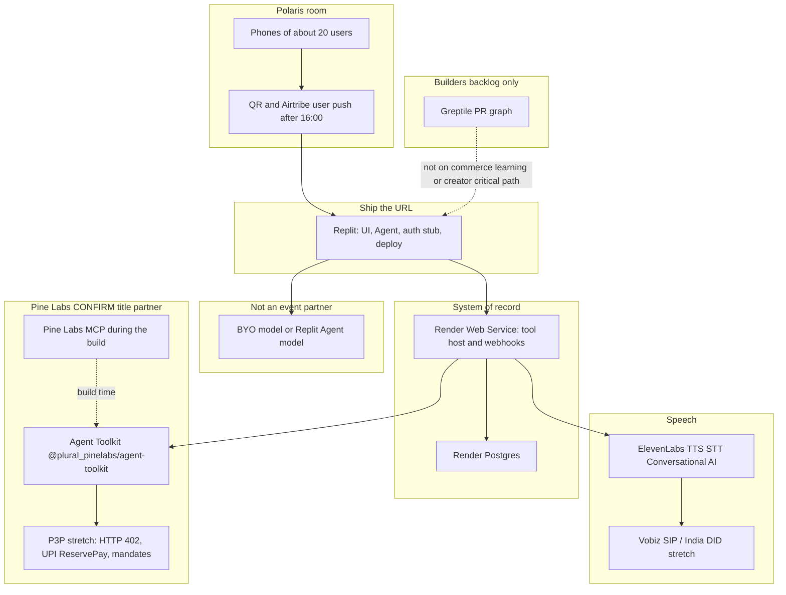
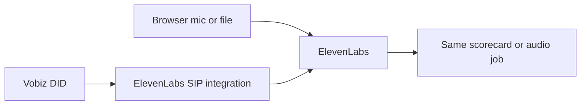

# Partner stack architecture

Shared picture for every idea in this portfolio. Idea docs name how a product uses the stack. This doc names **how each partner plugs in**, what is published for 24 October 2026, and what is only a plausible booth card.

Saturn / Gaia: critique the proposals in [§8](#8-proposals-worth-attacking). Write decisions into [unified ideas](06-unified-ideas.md). Do not treat an **INFER** card as a brief that was handed out.

## 1. Label rule

| Label | Use it when |
|---|---|
| **CONFIRM** | The Airtribe event page, foundercal listing, or an Airtribe LinkedIn post for **this** event states it, or a partner doc states a product capability we are only describing (not claiming as a booth challenge). |
| **INFER** | A numbered problem we think a booth might set, based on the partner’s product and prior hackathons. The [problem archive](research/builders-day-partner-problem-statements.md) found **no published per-company problem pack** as of 23 October 2026. |
| **PROPOSAL** | A wiring choice this portfolio suggests. Open. |
| **UNKNOWN** | Not in the research, not in this repo (Chotuchotu internals, exact credit amounts, Community Partner name). |

Sponsor page line, **CONFIRM** as a mechanism only: custom activations may include “live challenges.” That sentence does not confirm any challenge’s content. Source: [airtribe.live/ai-builders-day/sponsor](https://airtribe.live/ai-builders-day/sponsor), quoted in the problem archive.

If kickoff slides or a booth one-pager name a challenge, upgrade that one card from **INFER** to **CONFIRM** in the unified doc. Until then, leave the label.

## 2. Who is actually in the room

**CONFIRM** roster from the [partner memo](research/builders-day-partners-and-market.md):

| Role | Org | What builders get on this event |
|---|---|---|
| Organiser | **Airtribe** | Mentors (10+), workshops, solo matchmaking, program credits for winning-team members (₹1.5L cited), the 20-user brief |
| Venue | **Polaris School of Technology** | Room and foot traffic at DivyaSree Technopark A3, Brookefield. Not a problem author |
| Title / powered by | **Pine Labs** | Event-day credits (amount unpublished), online payments, Agent Enablement Toolkit, MCP server, P3P. Keynote by Sanjeev Kumar |
| Venture | **Peer Capital** | Investment-intent pitch. Judge: Karthik Prabhakar. No API |
| Judge | **Gaurav Mittal** | Payments-tech lens. Public profile ties him to Pine Labs; **confirm the badge on the day** |
| Judge | **Pratyush Choudhury, Activate** | **CONFIRM** as a judge via Airtribe LinkedIn. Activate is **not** the venture slot on the partner strip (Peer Capital is). No API |
| Toolkit | **Greptile** | Event-day credits. Code-graph PR understanding |
| Toolkit | **ElevenLabs** | Event-day credits. TTS, STT, Conversational AI, voice design/clone |
| Toolkit | **Replit** | Event-day credits. Agent, deploy, auth/DB, phone URL |
| Toolkit | **Render** | Event-day credits. Web services, Postgres, TLS |
| Toolkit | **Vobiz** | Event-day credits for AI voice/telephony. SIP, India numbers, WebRTC. ElevenLabs integration exists in Vobiz docs |

**CONFIRM absence:** no LLM vendor (OpenAI, Anthropic, Google) is named as a partner. No WhatsApp BSP, Razorpay, Stripe, or Clerk. Community Partner slot “Community 03” has **no published name** — do not invent one. Mentor firms are incompletely published.

Event-day **credit amounts** for Pine Labs, Replit, Render, ElevenLabs, Greptile, and Vobiz are **UNKNOWN** publicly. Vobiz’s own new-account ₹25 is a product fact from the partner memo, not the event grant.

## 3. System sketch

**PROPOSAL.** One shape, four callers. Saturday may drop Render and run entirely on Replit if claiming two hosts is the thing that slips. The diagram shows the full proposal so a critique can delete boxes.

**Secrets.** Merchant keys and ElevenLabs keys live on the server that calls the partner (Render Web Service **or** a Replit secret). They do not ship to the browser.

**Idle risk, CONFIRM from Render’s free-tier docs** as cited in the partner memo: free web services spin down after about 15 minutes idle and cold-start slowly. A keepalive ping, or Replit as the only public URL, is part of the design. Postgres on Render is still useful if the web service is warm before judging.

## 4. How each partner plugs in

### 4.1 Airtribe — process, not an SDK

**CONFIRM.** Open brief: in 12 hours, ship an AI product and land ~20 real users outside the team before 19:30. Four track briefs (Learning, Commerce, Builders, Creators), quoted in [overview](00-overview.md) and the problem archive.

**INFER.** Mentor framing about shipping one outcome instead of polishing a repo. Use it as a habit, not as a numbered challenge.

**Plug-in.** No library. The architecture has to expose a public phone URL by the early afternoon and a counter of unique users that a mentor can believe (rows in Postgres or Replit’s DB, not a spreadsheet edited on stage).

**Ideas.** All four, plus backlog.

### 4.2 Pine Labs — money and agent checkout

**CONFIRM capabilities** (product docs, cited in the partner memo and problem archive):

- Docs hub: [pinelabs.com/docs/online-payments](https://www.pinelabs.com/docs/online-payments)
- **Agent Enablement Toolkit** `@plural_pinelabs/agent-toolkit` for LangChain, OpenAI Agents, and the Vercel AI SDK. Tools: `createOrder`, `getOrder`, `cancelOrder`, `createRefund`. [Toolkit](https://www.pinelabs.com/docs/online-payments/ai/agent-enablement-toolkit)
- **MCP server** so a coding agent can operate payment APIs in natural language during the build. [AI solutions](https://www.pinelabs.com/docs/online-payments/ai)
- **P3P:** HTTP 402 agent-native payments. UPI ReservePay and cards described as available; one-time mandates are part of the framing in the problem archive. [P3P quickstart](https://www.pinelabs.com/docs/online-payments/ai/p3p/quickstart)

**CONFIRM for this event:** title partner, event-day credits of unpublished size, keynote title.

**INFER booth cards** (do not print these as if Pine Labs issued them):

1. Agent that buys, not recommends — shortlist **and** an order or payment link.
2. UPI micro-SKU under ₹199 from a natural-language order.
3. Refund narrator — plain language plus `createRefund` / `cancelOrder`.
4. Mandate-bounded shopper — cap, then a receipt.
5. Kirana list → Hinglish offer → payment link.

**PROPOSAL wiring.**

- Shopping AI and Grocery AI call one server-side wrapper: `pay(amount, sku_label, user_id) → {order_id, url}` implemented with `createOrder` or a payment link.
- The browser opens `url`. A return path calls `getOrder` and writes the row.
- `cancelOrder` and `createRefund` sit behind a staff button, not the homepage.
- P3P mandate UI is a second screen shown only with working credentials. Otherwise the speaker describes it and the live path stays the payment link.
- Prefer sandbox. Do not promise production settlement.

**Ideas.** Required for [Shopping AI](01-shopping-ai.md) and [Grocery AI](02-grocery-ai-cadences.md). Not day-one for visual learning. Optional later for Chotuchotu paid download.

**Failure.** If the booth credential is late, ship the non-payment artifact and label the receipt **mock**. Saying a charge succeeded when it did not is worse than a shortlist.

### 4.3 ElevenLabs — speech layer

**CONFIRM.** Toolkit partner, event-day credits. Public free tier cited in the partner memo: 10k credits/month covering TTS, STT, and agents. [Pricing](https://elevenlabs.io/pricing).

**INFER cards:** conversational coach; vernacular explainer of one PDF page; phone studio voiceover and captions; speech engine on the team’s own logic; English → Hindi/Hinglish dub.

**PROPOSAL wiring.**

| Use | API surface to plan for | Idea |
|---|---|---|
| Read a finished script | TTS | Chotuchotu required path; Grocery “read my list”; visual-learning card narration |
| Turn a human take into text | STT | Chotuchotu if a scratch voice exists; optional shopping or grocery voice input |
| Multi-turn voice agent | Conversational AI | Visual-learning oral viva stretch; backlog L1 interview coach |
| A made-up character voice | Voice Design / clone | Chotuchotu stretch, with consent |

Browser mic and files first. Keys on the server. A toggle so a slow voice call cannot block the 20-user script (visual learning defaults narration **off**; Chotuchotu cannot, because audio is the point).

**Failure.** Hall noise and credit burn. Every voice idea needs a text path except Chotuchotu, where the fallback is a shorter script, not silence presented as success.

### 4.4 Vobiz — telephony under the agent

**CONFIRM.** Toolkit partner. Airtribe LinkedIn offers credits to explore AI-native voice and telephony — that sentence is a soft hint, so the **problems stay INFER**. Product: [vobiz.ai](https://vobiz.ai/) SIP, India DIDs, WebRTC. ElevenLabs SIP integration: [docs](https://www.vobiz.ai/docs/integrations/elevenlabs). Signup credit ₹25 is a product fact; this event’s extra credit is a tagged-claim pattern, amount **UNKNOWN**.

**INFER cards:** agent on a real number judges can dial; outbound practice call with consent; one inbound DID for the day; browser first then PSTN; missed-lead callback.

**PROPOSAL wiring.** Vobiz is never the only path.

The app’s domain logic (quiz, list, script) does not import SIP. A thin adapter posts “call ended, transcript or recording url” into the same job type the browser path uses.

**Ideas.** Stretch for Chotuchotu (phone-in voice take) and Grocery (dictate a list). Not required for Shopping AI. Natural home for backlog L1 if the team pivots to a coach that calls.

**Failure.** DID provisioning slips. Demo the browser path and show the DID diagram. The partner memo’s guidance is web voice first.

### 4.5 Replit — the phone URL

**CONFIRM.** Toolkit, event-day credits, Agent plus deploy. Fastest official path to a URL a stranger’s phone can open.

**INFER cards:** plain-English tiny app deployed in minutes; a URL with one real DB write before the user push; several tiny apps for other booths; an app that speaks; a multiplayer agent room.

**PROPOSAL wiring.** Replit hosts the UI for whichever idea is demoed. Auth is a name on a form or Replit’s built-in auth stub — enough to count unique people, not a production identity system. If the Agent generates code, constrain it to the templates in the idea doc (catalog checkout, cadence plan, lesson cards, audio attach). Arbitrary code execution is the B3 risk in the VC map; do not open that hole for Commerce or Learning.

**Ideas.** All four, unless Chotuchotu’s existing host is already a public phone URL. Then Replit is only the audio page.

### 4.6 Render — host, database, webhooks

**CONFIRM.** Toolkit and credits. Free web service, managed TLS, Postgres limits cited in the partner memo. Spin-down caveat above. Credits redemption: [render.com/docs/credits](https://render.com/docs/credits).

**INFER cards:** public HTTPS API; Postgres holding the 20 user events; a demo that survives idle spin-down; backend for tool-calling while UI lives elsewhere.

**PROPOSAL wiring.**

- Tables, one database, prefixed by idea: `shop_orders`, `groc_plans`, `learn_attempts`, `studio_audio_jobs`.
- Render Web Service is the only component that holds Pine Labs and ElevenLabs secrets, **if** the team splits hosts.
- Pine Labs return URL hits Render, which updates Postgres, which the Replit page polls.
- Alternative **PROPOSAL** if two hosts are too many: Replit-only, its DB, secrets in Replit. Render stays the backup slide. Pick one before noon and do not run both half-configured.

**Ideas.** Every idea that needs a judge-visible counter. Highest value for Shopping and Grocery (order state) and for the learning attempt log.

### 4.7 Greptile — repository understanding

**CONFIRM.** Toolkit, event-day credits. Public Starter cited as 50 credits/month, one developer. Product uses graph context over a repo ([greptile.com](https://www.greptile.com/)).

**INFER cards:** PR risk card; blast-radius map; merge coach; API fire-drill; “will this change break payments?” in plain language.

**PROPOSAL wiring.** Greptile is **not** imported by Shopping, Grocery, visual learning, or Chotuchotu. It plugs into:

- backlog **B2 / B5** if the team pivots to a Builders-track demo, and
- optionally the team’s own pull request while building, as a staff tool.

Putting Greptile in a commerce homepage will look like a second product. Leave it out of the user flow.

### 4.8 Peer Capital — pitch lens

**CONFIRM.** Venture partner. Karthik Prabhakar judges. Finalists can seek investment intent. No toolkit.

**INFER problems** from the public thesis ([Substack](https://peercapitalvc.substack.com/p/the-india-ai-renaissance-from-services)): sell the work; voice as an India interface; commerce that converts; skilling with a visible loop; services-as-software.

**Plug-in.** The sentence on the table card, not a library.

| Idea | Outcome sentence |
|---|---|
| Shopping AI | Agent that buys, not chat that recommends. |
| Grocery AI | The weekly basket for this household, then a pay action. Cadence is the product. |
| Visual learning | A lesson from your page, with a score you can show. |
| Chotuchotu | The studio finishes the voice, in the script’s language. |

Show India-shaped complexity that the demo actually contains: UPI via Pine Labs, a price book in rupees, Hindi or Kannada or Hinglish where the idea uses it. Do not claim a moat the prototype does not run.

### 4.9 Activate — additional judge lens

**CONFIRM** role via Airtribe LinkedIn. Problems **INFER**: would a founder still work on this Monday; phone and vernacular; a real rail (state, auth, payments, voice) rather than glitter. Thesis site cited in the problem archive: [activatevc.ai](https://www.activatevc.ai/).

**Plug-in.** Same demos. Be ready to show where state lives (Postgres tables) and which partner call is real.

### 4.10 Polaris — venue

**CONFIRM** host. **No** Polaris-authored challenge list was found. Use the crowd as the user pool. Do not cite older campus hackathons as this event’s brief.

## 5. Which idea exercises which partner

| Partner | Shopping AI | Grocery AI | Visual learning | Chotuchotu | Backlog |
|---|---|---|---|---|---|
| Airtribe brief | Commerce **CONFIRM** | Commerce **CONFIRM** | Learning **CONFIRM** | Creators **CONFIRM** | L1 Learning; B1/B3 Builders; CR1 Creators |
| Pine Labs Toolkit / link | Required | Required | — | Later | — |
| Pine Labs P3P | Stretch | Stretch, monthly cap | — | — | — |
| ElevenLabs | Optional STT | Optional TTS | Optional TTS; viva stretch | Required TTS | L1 Conversational AI; CR1 captions |
| Vobiz | Not critical | Stretch | Viva stretch | Stretch phone-in | L1 stretch |
| Replit | URL | URL | URL | URL if studio has none | B1/B3 core |
| Render | Orders | Plans | Attempts | Audio jobs | B3 alternate host |
| Greptile | Staff only | Staff only | Staff only | Staff only | B2/B5 product |
| Peer Capital | Pitch | Pitch | Pitch | Pitch | Pitch |

## 6. Day-of claim sequence

**PROPOSAL**, ordered so a late booth does not erase the afternoon.

1. Replit account and a public URL with a placeholder homepage. This unblocks every idea.
2. ElevenLabs key. Required if the demo is Chotuchotu; optional otherwise.
3. Pine Labs sandbox merchant. Required if the demo is Shopping or Grocery. Ask for Agent Toolkit credentials and a payment-link example. Ask separately whether P3P is enabled. Record the answer in the unified stub.
4. Render Postgres only if the counter must survive a Replit-only design being rejected. Start the service early so spin-down is understood.
5. Vobiz DID last. If it is not live an hour before user push, drop it from the script.
6. Greptile only if the judged product is a PR narrative.

Bring-your-own model key in parallel. There is no partner booth for it.

## 7. Explicit non-integrations

- **TableTalk** is a separate product. No tables, no routes, no partner mapping.
- **Community Partner:** unnamed. No adapter.
- **WhatsApp BSP, Razorpay, Clerk, Stripe:** not partners. Pine Labs is the payment path. A magic-link vendor is optional only as a BYO choice and should not be required for 20 users.
- **Quick-commerce private APIs** (market context for Grocery): no adapter until a real agreement exists. Saturday’s vendor is a price book.
- **Image-generation APIs** for visual learning: not partners. Diagrams are HTML/SVG or they are omitted.

## 8. Proposals worth attacking

These are the decisions most likely to be wrong. They are **PROPOSAL**s.

1. **Two hosts.** Replit for the URL plus Render for secrets and Postgres. Attack: one host is enough and the seam will break at 18:00. Defence: Pine Labs webhooks and a warm DB are awkward inside a pure Agent deploy. Pick before building.
2. **Payment link over P3P for the 20 users.** Attack: the keynote is P3P, so a link looks timid. Defence: a link is a real phone pay; a narrated mandate that never charged is a slide. Show P3P only with credentials.
3. **Shopping and Grocery share `pay()` and nothing else.** Attack: one Commerce app with a mode flag ships faster. Defence: cadence, pantry, and vendor quote are a different aggregate. See [Grocery](02-grocery-ai-cadences.md).
4. **Visual lessons without an image model.** Attack: “visual” that is only cards will disappoint. Defence: SVG from a tiny schema fails closed; a bitmap model is an unpartnered dependency.
5. **Chotuchotu audio as a side service `(media_ref, script, language)`.** Attack: the studio may already have a half-built audio hook, and a side service forks it. Defence: the private repo was not readable here. First hour of architecture time is reading it and deleting this service if a hook exists.
6. **Greptile stays off the four homepages.** Attack: a toolkit judge wants to see their product. Defence: a disconnected widget reads as bait. Use Greptile when the artifact is code.
7. **Text fallback for every voice feature except Chotuchotu.** Attack: the Learning brief says language and voice. Defence: the hall is loud; the scorecard still has to happen.

## 9. Critique checklist

- Can a mentor see 20 distinct user rows without trusting a verbal count?
- Which partner calls are live, which are mock, and does the UI say so?
- Does any **INFER** card appear in the pitch as if it were the official brief?
- Is Grocery’s cadence stored, or only written in the prompt?
- Does Shopping AI refuse products that are not in the catalog?
- Does visual learning refuse to teach when extraction is empty?
- Does Chotuchotu’s audio path name a real export from the private repo?
- Where do Pine Labs and ElevenLabs keys sit?
- What happens when Render has been idle for 20 minutes?
- What is the one sentence Peer Capital hears, and is it true of the build on the table?
