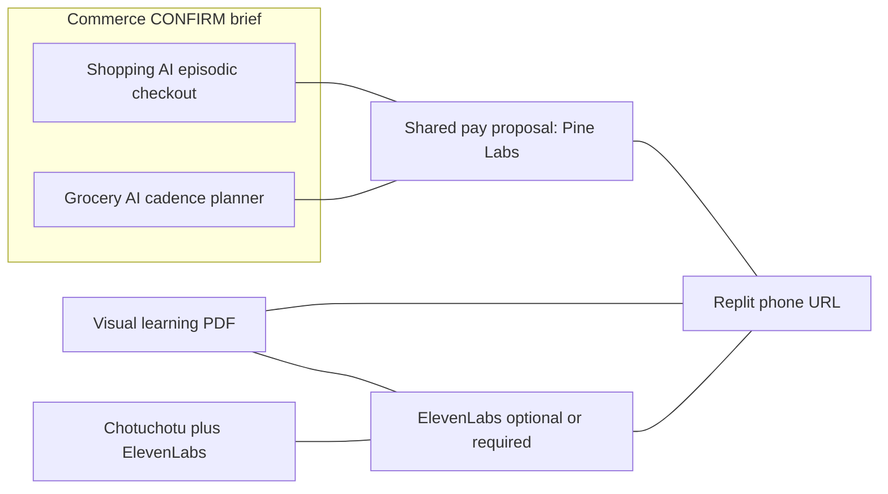

# Unified ideas

Single pane for the portfolio. Detail lives in the linked docs. This page is the one to keep open in an architecture discussion.

**No bet is locked.** Status describes documentation, not a running app.

## Status legend

| Status | Meaning |
|---|---|
| **idea** | Problem and user are named. No partner wiring yet. |
| **research** | Grounded in the [archive](research/). Booth cards still labeled CONFIRM or INFER. |
| **architecture** | A sketch names partner tools, a 20-user demo, and open questions. Ready for Saturn / Gaia to accept or replace. |

Everything first-class below is **architecture**. Nothing has moved to a build repo.

## Matrix

| Idea | Track | One-line | Partners it actually needs | Day-of problem shape | Label of that shape | Status | Doc |
|---|---|---|---|---|---|---|---|
| **Shopping AI** | Commerce | Budget + constraints → 3 tradeoff picks → Pine Labs pay | Replit URL; Pine Labs Toolkit or payment link; BYO model; Render if the order log is split out. ElevenLabs optional. P3P stretch | “Agent that buys, not a chat that recommends” (payment link / `createOrder`, sandbox OK) | **INFER** Pine Labs card 1. Commerce brief is **CONFIRM** | architecture | [01](01-shopping-ai.md) |
| **Grocery AI** | Commerce vertical | Same household, three clocks — daily / weekly / monthly — then a vendor quote and pay | Replit; Pine Labs; price book in Postgres (Render or Replit); BYO model. ElevenLabs read-aloud optional. Vobiz stretch. P3P stretch on monthly | Kirana list → offer → collect is the nearest card. **Cadence itself is not a published card** | Card: **INFER** Pine Labs 5 (and card 2 for a daily top-up). Cadence: **PROPOSAL** | architecture | [02](02-grocery-ai-cadences.md) |
| **PDF → visual learning** | Learning | One PDF page → visual cards, one diagram, 3 grounded questions | Replit; BYO model; Render for attempts. ElevenLabs TTS optional. Vobiz only if oral viva is added | “Teach this page in the learner’s language and check them” | Learning brief **CONFIRM**. ElevenLabs vernacular card **INFER** | architecture | [03](03-visual-learning-pdf.md) |
| **Chotuchotu** | Creators | Existing studio; add ElevenLabs audio. Vobiz phone-in is stretch | ElevenLabs TTS required for the gap. Replit only if the studio has no public URL. Render for the audio job log. Vobiz stretch. Studio repo **UNKNOWN** here | “Full studio in one phone, any Indian language” plus a VO/caption layer | Creators brief **CONFIRM**. ElevenLabs VO card **INFER** | architecture | [04](04-chotuchotu-studio.md) |
| L1 Interview Drill Coach | Learning | 5-min voice mock interview → scorecard | ElevenLabs Conversational AI; Replit; Vobiz stretch | Voice coach that speaks, not a TTS of a chat reply | **INFER** ElevenLabs card 1. Brief **CONFIRM** | research (backlog) | [07](07-backlog-demos.md) |
| B1 Multiplayer Prompt Room | Builders | One URL, many phones, one agent session | Replit; realtime layer is **not** a named event partner | Shared agent, not private chat | **INFER** Replit card 5. YC multiplayer is external demand, not a booth card. Builders brief **CONFIRM** | research (backlog) | [07](07-backlog-demos.md) |
| B3 Small Software Deploy | Builders | Plain English → hosted tiny app | Replit Agent; Render optional; Greptile optional flourish | Non-coder describes a tool and gets a URL | **INFER** Replit card 1. Builders brief **CONFIRM** | research (backlog) | [07](07-backlog-demos.md) |
| CR1 Clip Autopilot | Creators | Long clip → 3 vertical shorts | Replit + a cutter. ElevenLabs for VO/captions. No official video-gen partner | Studio-in-a-phone / clip to captioned shorts | Brief **CONFIRM**. Cutting pipeline is the backlog twin of Chotuchotu | research (backlog) | [07](07-backlog-demos.md) |

Peer Capital and Activate appear on every row as **pitch lenses**, not as dependencies. Airtribe appears on every row as the 20-user process. Greptile appears as a product dependency only on a Builders backlog pivot.

## How the four first-class ideas sit together

Shopping AI does not store a cadence. Grocery AI does not rank earbuds. Visual learning does not charge. Chotuchotu does not become a tutor. Shared pieces are the phone URL, the optional Postgres counter, and — for the two commerce ideas only — a checkout function. That sharing is a [proposal](05-partner-stack-architecture.md), not a merge.

## Partner coverage at a glance

| If the room asks for… | Label today | Portfolio response |
|---|---|---|
| Official Commerce brief | **CONFIRM** | Shopping AI or Grocery AI, said as two products |
| Official Learning brief | **CONFIRM** | Visual learning |
| Official Creators brief | **CONFIRM** | Chotuchotu audio path; CR1 only if the studio cannot boot |
| Official Builders brief | **CONFIRM** | Not a first-class product. Backlog B3 or B1 |
| “Complete a purchase” | **INFER** Pine Labs | Shopping AI Flow A. Grocery if they want a basket instead of a shortlist |
| “Speak / call” | **INFER** Vobiz + ElevenLabs | Chotuchotu voice, or Grocery read-aloud, or backlog L1. Browser before DID |
| “Live URL a non-coder described” | **INFER** Replit | Any idea’s homepage; B3 if the product *is* the generator |
| “Artifact in under 2 minutes” | **INFER** Peer / Activate | Receipt, cadence plan, scorecard, or audio file |
| “Blast radius of a PR” | **INFER** Greptile | Backlog, not the four |
| 20 users before 19:30 | **CONFIRM** Airtribe | Whichever URL is actually up |

When a booth hands a written card, copy it into the matching stub below and change the label to **CONFIRM**.

## Saturday shape, still unlocked

Each idea’s 20-phone demo is specified in its own doc. Common bar:

- Public URL, one-tap name, AI loop on the homepage.
- Artifact in about two minutes: receipt or honest mock, cadence plan, scorecard, or audio file.
- Counter of unique people.
- Partner call that is live is labeled live. Partner call that is mocked is labeled mock.
- Sandbox money is not described as a delivered good. A lesson is not described as a full course. A voice file beside a video is not described as a finished theatrical cut.

The build window inside the 12-hour day is tight. The research memos plan for a URL around 16:00 and users before 19:30. Whichever idea is picked up that morning still leaves the other three documented.

## Research pointers

| Question | Archive |
|---|---|
| What do YC, Sequoia, a16z, Accel, Peak XV, Lightspeed, Peer Capital say they want? | [VC map](research/builders-day-vc-research.md) |
| Who is confirmed on this event, and what can their tools do in a few hours? | [Partners and market](research/builders-day-partners-and-market.md) |
| Which problem statements were actually published? | [CONFIRM vs INFER](research/builders-day-partner-problem-statements.md) |
| How does a tool plug into the system? | [Partner architecture](05-partner-stack-architecture.md) |

Earlier “top 3 bets” in the partner memo were L1, C2 with Pine Labs, and B3 or B1. This portfolio **keeps C2’s commerce job** and widens it into Shopping AI, **adds Grocery as its own vertical**, **keeps L2’s learning job** and makes it visual, and **keeps the creator job** as Chotuchotu rather than a new cutter. L1, B1, B3, and CR1 stay on the backlog. That is a change of emphasis, not a claim the earlier bets were wrong.

---

## Saturn / Gaia — architecture discussion stubs

Fill these in discussion. Leave the prompt text. Add decisions under each heading. Do not delete the open questions; mark them resolved when they are.

**How to write a decision:** one paragraph, the alternative rejected, and which doc must change if the decision sticks. If a partner booth upgrades a card to CONFIRM, paste the card text.

D1–D4 below are Saturn’s decisions from 2026-10-23. D5–D8 stay empty stubs for Gaia to amend.

### Discussion log

| Date | People | Topic | Decision id |
|---|---|---|---|
| 2026-10-23 | Saturn | Host split; Pine Labs rail; Shopping × Grocery; Grocery demo cadence | D1–D4 |
| 2026-10-23 | Gaia (owns separately) | Visual lesson fidelity; Chotuchotu audio; Greptile and Vobiz; Saturday demo — stubs left open | D5–D8 |

### D1 — Host split

- **Question:** Replit only, or Replit UI plus Render secrets/Postgres? See [partner architecture §8.1](05-partner-stack-architecture.md). **Resolved 2026-10-23 (Saturn).**
- **Decision:** Replit-only for Saturday as the public phone URL, auth stub, DB counter, and secrets host. Render Web Service + Postgres stays documented as a backup slide / post-event shape, not a second live host on the day.
- **Gaia alternative (conditional):** If the Saturday demo is Commerce (Shopping/Grocery), prefer Replit UI + Render secrets/Postgres for Pine Labs webhooks and merchant keys; if Learning or Creators, Replit-only is enough.
- **Rejected alternative:** Dual Replit UI + Render secrets/Postgres on Saturday (seam risk near 18:00; Airtribe URL + 20-user counter must not depend on two half-configured hosts).
- **Follow-through:** The §3 diagram caption and §8 item 1 in [partner architecture](05-partner-stack-architecture.md) now record Saturday’s primary pick as Replit-only. Render table names stay for later. Warm-up / keepalive notes still apply if anyone later turns Render on.

### D2 — Pine Labs rail

- **Question:** Payment link, Toolkit `createOrder`, or P3P mandate for the judged pay tap? Credentials actually received at the booth: **UNKNOWN** as of 2026-10-23. **Resolved 2026-10-23 (Saturn)** for the rail; paste the booth credential answer on this line when it arrives.
- **Decision:** Judged pay path is Pine Labs Agent Toolkit `createOrder` (or the payment-link equivalent from the Toolkit) returning `{order_id, url}`. The browser opens `url`. The return path calls `getOrder` and writes the order row. P3P / UPI ReservePay / mandates are a stretch second screen only if booth credentials confirm P3P is enabled; otherwise narrate from the keynote and keep the live path on the link. Partner tools stay first-class: Pine Labs Agent Toolkit, MCP at build time, and P3P as stretch — not a generic payment gateway.
- **What the UI is allowed to say:** “Sandbox payment” or “Demo order” when the call is sandbox. Never claim settlement or delivered goods for sandbox or mocks. If credentials are late, ship the shortlist or cadence artifact and label the receipt **mock**.
- **Follow-through:** Shared server-side `pay(amount, sku_label, user_id)` wrapper on Replit. `cancelOrder` and `createRefund` are staff-only. Record booth credential answers in this stub when known. Noted on [partner architecture §8](05-partner-stack-architecture.md) item 2.

### D3 — Shopping AI × Grocery AI

- **Question:** Two products with a shared `pay()`, or one app with a mode? Cadence storage if Grocery stays separate: **Resolved 2026-10-23 (Saturn).**
- **Decision:** Two products. They share only `pay()` and the Replit URL / user-counter pattern. No mode flag merges them. Grocery owns `groc_plans` (or the Replit DB equivalent) with daily, weekly, and monthly clock fields as first-class data, not prompt text. Shopping owns the episodic shortlist and checkout and has no cadence fields.
- **Rejected alternative:** One Commerce app with a mode switch. That collapses the Grocery thesis that cadence is the product.
- **Follow-through:** Idea docs [01](01-shopping-ai.md) and [02](02-grocery-ai-cadences.md) stay separate. The matrix on this page stays two rows. Noted on [partner architecture §8](05-partner-stack-architecture.md) item 3.

### D4 — Grocery demo cadence

- **Question:** Which clock is polished (proposal: weekly), and are daily and monthly still one tap? **Resolved 2026-10-23 (Saturn).**
- **Price book owner and freeze time:** Team-owned static book in the DB. Freeze by noon Saturday. No quick-commerce private APIs.
- **Charge:** Full sandbox basket total via the Pine Labs path, clearly labeled sandbox. Not a silent ₹ hold that judges might misread as production.
- **Decision:** Polish **weekly** for the judged path: household basket, then a vendor quote from the price book, then pay. Daily and monthly remain one-tap secondary demos using the same plan schema.
- **Follow-through:** Seed the weekly plan and the price book in the Replit DB early afternoon.

### D5 — Visual lesson fidelity

- **Question:** Citation cards only, or cards plus the SVG diagram spec?
- **Booth sample page (rights):**
- **Languages in the 20-user script:**
- **Narration default:** off, proposal stands unless changed.
- **Decision:**
- **Follow-through:**

### D6 — Chotuchotu audio interface

- **Repo / branch / what “checkout autoshort” means:**
- **Export the audio service can take:**
- **Public at the venue: yes / no**
- **Mux audio into video: yes / side-by-side files**
- **ElevenLabs voice ids (English / Hindi / Hinglish):**
- **Vobiz in the Saturday script: yes / no**
- **Decision:**
- **Follow-through:**

### D7 — Greptile and Vobiz scope

- **Greptile on a first-class homepage: no, unless this decision says yes.**
- **Vobiz DID status at noon:**
- **Decision:**
- **Follow-through:**

### D8 — What Saturday actually runs

This stub is the only place a single demo is allowed to be chosen, and only for the day. It does not retire the other ideas.

- **Demo chosen for the room:**
- **Why the others wait:**
- **Mock vs live partner calls:**
- **User-count method:**
- **Sentence for Peer Capital:**

### Parking lot

| Item | Owner | Note |
|---|---|---|
| Community Partner name, if revealed | | Do not invent before the logo is real |
| Exact event-day credit claim links | | |
| Gaurav Mittal badge employer | | Confirm on the day |
| TableTalk | | Separate product. Do not design it here |
