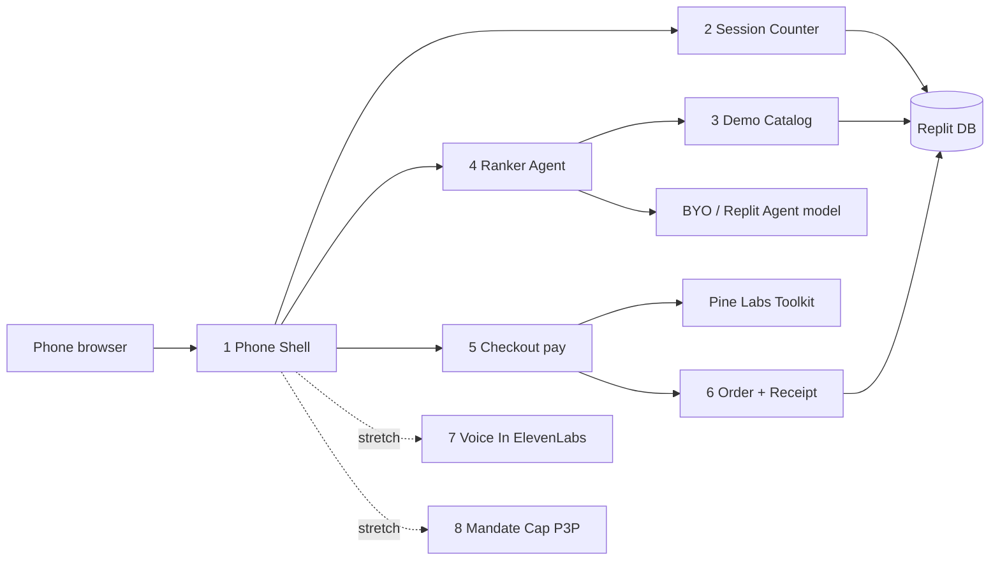

# Shopping AI — Saturday component stub

**Status:** day-of build plan for 24 Oct 2026. Documentation only until the build repo exists.
**Track:** Commerce.
**Demo:** Shopping AI (see [unified ideas D8](06-unified-ideas.md)).
**Host:** Replit-only (D1). Render is backup / post-event, not a live Saturday host.
**Audience:** 2 coders + optional booth person. Mentors want named modular components they can point at.

This stub locks the component list and ownership for tomorrow. It does **not** retire Grocery AI, visual learning, or Chotuchotu — those stay in their docs. Gaia’s conditional “Commerce → Replit UI + Render secrets/Postgres” is **rejected for tomorrow** under the 2-coder constraint; stay on Saturn D1.

## Day bar

| Milestone | Target (IST) |
|---|---|
| Freeze demo catalog | by noon |
| Public URL with Flow A working | early afternoon |
| Freeze build | ~16:00 |
| 20 outside users | before 19:30 |

Core loop: shortlist → Pine Labs Toolkit `createOrder` / sandbox pay on phone. The Ranker is a node in the [shared orchestration](09-shared-orchestration.md) DAG (supervisor routes; checkout is a button, not a free model call). Stretch: ElevenLabs voice; P3P mandate screen. Greptile and Vobiz stay off the homepage.

## Named components (label these on the architecture diagram)

### Must ship (judges can point at each)

| # | Component | What it is | Contract |
|---|---|---|---|
| 1 | **Phone Shell** | Mobile-web UI on the Replit public URL: QR landing, name stub, prompt chips, shortlist cards, Pay/Hold, receipt. Not a native app. | One public HTTPS URL a stranger’s phone can open. |
| 2 | **Session Counter** | Replit DB row per unique name / auth stub. Mentor-visible count. | No spreadsheet on stage. Count = row count. |
| 3 | **Demo Catalog** | Frozen 8–12 SKUs: `id`, price, criteria text. Team-owned demo catalog dated 24 Oct. | Allow-list only. Model may not invent products or prices. |
| 4 | **Ranker Agent** | BYO model or Replit Agent model. Input: need + budget + constraints. Output: exactly three catalog ids + tradeoffs. Re-ranks when a constraint changes. | Emits only catalog ids. If nothing fits, say so and ask which constraint to relax. |
| 5 | **Checkout Executor `pay()`** | Server-only wrapper: `pay(amount, sku_label, user_id) → {order_id, url}` via Pine Labs Agent Toolkit `createOrder` (or Toolkit payment-link equivalent). Browser opens `url`. | Merchant key never in the browser. Sandbox labeled “Sandbox payment” / “Demo order”. |
| 6 | **Order + Receipt** | Return path calls `getOrder`, writes the order row; UI shows a shareable receipt. | If credentials are late: shortlist stays real; receipt labeled **mock**. Never fake a successful charge. Never claim delivery. |

### Stretch (dashed on the diagram; off homepage until core is boring)

| # | Component | Partner | Rule |
|---|---|---|---|
| 7 | **Voice In** | ElevenLabs STT | Text chips remain the default in a loud hall. |
| 8 | **Mandate Cap** | Pine Labs P3P / ReservePay | Second screen only if booth confirms P3P is enabled; otherwise narrate the keynote and keep the live path on the payment link. |

### Staff-only (tiny box, not user flow)

- `cancelOrder` / `createRefund` behind a staff button.
- **Greptile** on the team’s own PRs during the build (D7). Not on the Shopping homepage.
- **Vobiz:** off (D7).

## Partner → component

| Partner | Maps to | Must / stretch |
|---|---|---|
| **Replit** | Phone Shell, Session Counter, secrets host, optional Ranker host | **Must** |
| **Pine Labs Toolkit** `@plural_pinelabs/agent-toolkit` | Checkout Executor, Order + Receipt | **Must** (sandbox OK) |
| **BYO LLM** (not an event partner) | Ranker Agent | **Must** |
| **Pine Labs MCP** | Build-time payment ops | Stretch (dev aid) |
| **P3P** | Mandate Cap | Stretch |
| **ElevenLabs** | Voice In | Stretch — off Shopping default script |
| **Render** | Backup slide only (D1) | **Do not ship Saturday** |
| **Greptile** | Staff PR review | Off homepage |
| **Vobiz** | — | Off |
| **Peer Capital / Activate** | Pitch sentence | Pitch, not a box |
| **Airtribe** | 20-user process | Process |

## Minimum modular split

Do **not** merge into one “app + LLM” blob. Minimum seams mentors can defend on a one-day build:

**UI (Shell) ≠ Agent (Ranker) ≠ Catalog ≠ Pay (`pay()`) ≠ State (Session + Orders)**

Five seams on **one** Replit host. Dual Replit + Render looks richer on a slide but burns the second coder on webhooks and cold-start — skip for tomorrow.

## Ownership (2 coders + booth)

| Who | Owns |
|---|---|
| **Coder A — Shell + Ranker UX** | Phone Shell, chips, 3-card UI, constraint re-rank, Session Counter display, Receipt UI, QR page copy |
| **Coder B — Catalog + Agent + Pay** | Seed catalog, Ranker allow-list contract + LLM call, `pay()` + secrets, `getOrder` return path, order rows, mock-receipt fallback flag |
| **Booth / third** | Claim Pine Labs sandbox at the booth, QR table, 2-minute user script, watch the counter |

**Peer Capital sentence:** “An agent that buys — shortlist under constraints, then a real Pine Labs pay action — not a chat that only recommends.”

**Cut order if behind:** Voice → Mandate Cap → Refund button → anything Render. Never cut Catalog allow-list or mock-label honesty.

## Decisions this stub records

| Decision | Choice | Rejected |
|---|---|---|
| Host (D1) | Replit-only for Saturday | Dual Replit UI + Render secrets/Postgres as the live plan |
| Gaia Commerce→Render conditional | **Rejected for tomorrow** (2-coder seam risk) | Turning Render on for Commerce on Saturday |
| Pay rail (D2) | Toolkit `createOrder` → `{order_id, url}` | P3P as the only judged tap without credentials; generic gateway |
| Product (D3 / D8) | Shopping AI demo; Grocery stays a separate product, not built tomorrow | Merging Shopping + Grocery into one mode-flag app |
| Voice / Greptile / Vobiz | Off Shopping homepage by default | ElevenLabs or Greptile on the critical path |

## Related docs

- [01 Shopping AI](01-shopping-ai.md) — product flows and risks
- [09 Shared orchestration](09-shared-orchestration.md) — lite DAG the Ranker and Checkout nodes sit inside
- [05 Partner stack](05-partner-stack-architecture.md) — D1 host, D2 rail
- [06 Unified ideas](06-unified-ideas.md) — D1–D8 discussion log
