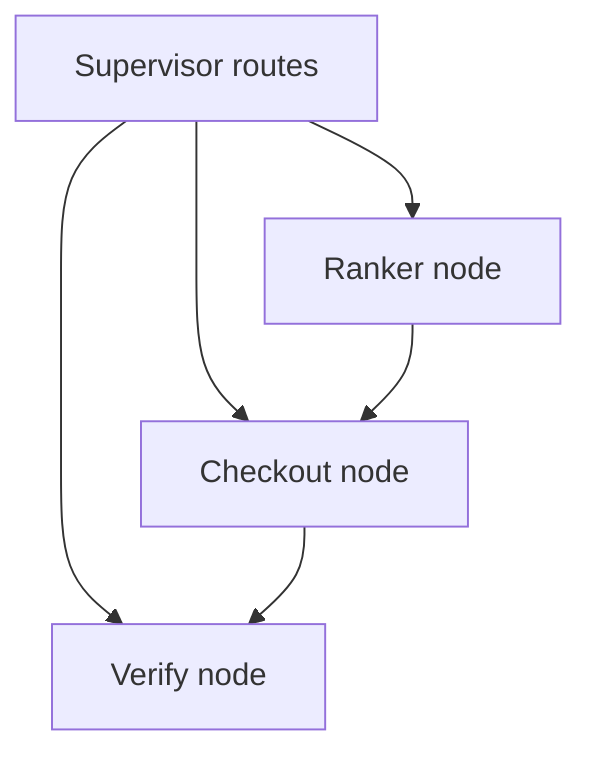

# Shared agent orchestration — lite extract for Builders Day

**Status:** locked for Sat 24 Oct 2026. Shopping is the default demo. Grocery and Chotuchotu use the same pattern with different nodes.
**Sources:** Neptune framework memo ([full decision](research/agent-orchestration-memo.md), AI SDK default) and Gaia’s inventory of [`agentswitch-web-agent`](https://github.com/levelscorner/agentswitch-web-agent) (shape only).
**Not a port:** learn from agentswitch. Do **not** rewrite the Replit apps into the Python DAG platform.

## What “map across repos” meant

Open the old projects, list what already exists (memory, DAG, harness), and say what to **borrow**. There is no full agentswitch port into Replit.

## Agentic vs Ranker

| | Agentic loop | Ranker loop |
|---|---|---|
| Control | Model wanders until done | Bounded: constraints → allow-list catalog → fixed N ids |
| Saturday Shopping | Risky | **Default** |

Ranker is a **node inside** a lite multi-agent DAG, not a replacement for multi-agent.

## Lite multi-agent DAG (agentswitch shape, AI SDK runtime)

From [`agentswitch-web-agent`](https://github.com/levelscorner/agentswitch-web-agent): a supervisor plans, routes workers, and each worker is a subgraph. **Verify from truth**, not from the model’s words.

| Node | Job | Saturday contract |
|---|---|---|
| **Supervisor** | Routes only (rank vs pay vs verify) | No free-form agent goals |
| **Ranker** | AI SDK tool loop: constraints → catalog → exactly 3 ids | Allow-list SKUs only |
| **Checkout** | UI button → server `pay()` via Pine Labs Toolkit | Never model free-calling `createOrder` |
| **Verify** | `getOrder` / DB row / mock label | Honest mock; never fake success |

**Runtime default:** Vercel AI SDK + Pine Labs `@plural_pinelabs/agent-toolkit/ai-sdk`. Session in Replit DB.

## Lite extract — keep vs skip

| Keep (idea / thin code) | Skip tomorrow |
|---|---|
| Supervisor that only **routes** | Full MCP platform client |
| Ranker **node** = AI SDK tool loop | Parallel subgraphs for every goal |
| Checkout **node** = button → server `pay()` | Model free-calling `createOrder` |
| Verify **node** = `getOrder` / mock label | glc_v5 gateway, S16 event engine |
| Working + episodic memory (session + last shortlist) | 3-tier platform mirror |
| Light retries from reliability idea | Custom circuit-breaker framework |

**Formula:** your DAG shape + Neptune’s AI SDK runtime + allow-list harness.

## Chotu variant (same pattern, different nodes)

Supervisor → **Script node** → **Voice node** (ElevenLabs) → **Verify** (file plays / job row). No Ranker and no catalog. See the [Chotuchotu Saturday walkthrough](04-chotuchotu-studio.md#saturday-walkthrough).

## Full decision memo

Framework comparison tables, the cheapest Ranker design, and the risks to act on first are in the [Neptune orchestration memo](research/agent-orchestration-memo.md). Saturday’s runtime default remains AI SDK. OpenAI Agents SDK is the runner-up (Node 22+ risk on Replit).

## Related docs

- [Saturday Shopping components](08-shopping-ai-saturday-components.md) — named boxes the Ranker and Checkout nodes sit inside
- [How to approach any problem tomorrow](10-tomorrow-problem-approach.md) — eight steps; same pattern if a booth card changes the product
- [Shopping AI](01-shopping-ai.md) — product flows
- [Chotuchotu](04-chotuchotu-studio.md) — Saturday walkthrough
