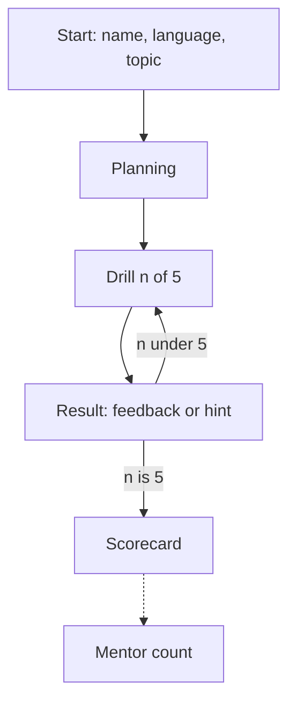
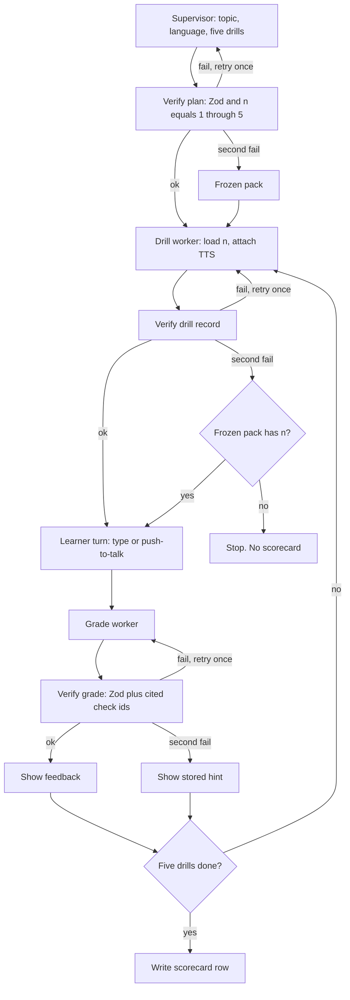
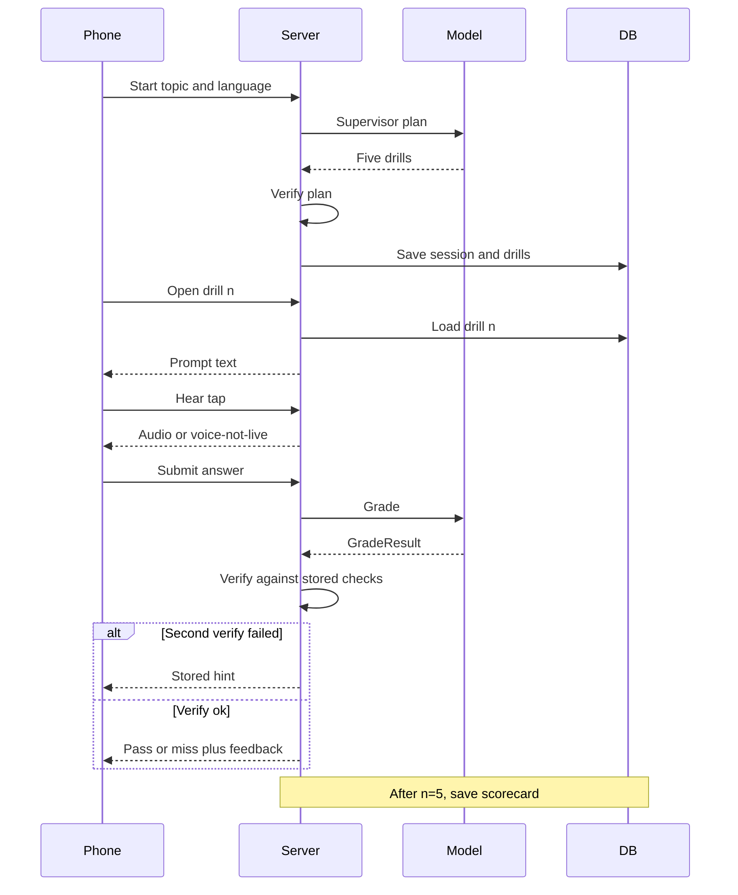
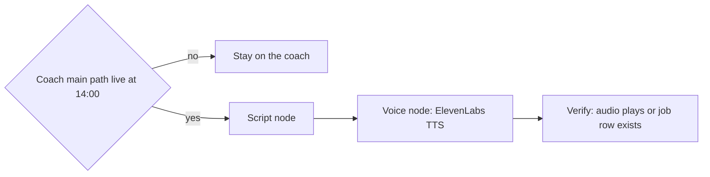

# App flow — vernacular Learning coach

| | |
|---|---|
| Owner | Saturday build pack. Critique: Venus. |
| Status | Active Saturday spec for 24 Oct 2026. Docs only. |
| Last updated | 2026-10-24 |

## Change log

| Date | Change |
|---|---|
| 2026-10-24 | Initial screen flow and Learning DAG. |

Flow changes that change scope or schema update this change log, the affected doc, and [CHECKLIST.md](CHECKLIST.md) in the same PR.

Labels: [README](../../README.md#labels-used-everywhere). Screens assume the stack in [02-technical-requirements](02-technical-requirements.md).

## Screens

One column. One job per screen. Copy tone: [04-design-brief](04-design-brief.md).

| Screen | What the learner sees | Primary action | Empty / waiting / error |
|---|---|---|---|
| 1. Start | Name, language (English / Hindi / Hinglish), topic chips plus a short topic line | Start | Empty name or empty topic: stay here and say which field is missing |
| 2. Planning | “Making 5 drills” and the topic | Wait | After the one retry fails: “Using today’s practice set,” then screen 3 |
| 3. Drill | “Drill n of 5”, topic, prompt text, Hear, answer box, Hold to talk, Submit | Submit | Hear disabled when no audio. Mic denial: one line, box stays. Empty answer: do not submit |
| 4. Result | Pass or miss with feedback, **or** the stored hint | Next | Hint path has no pass mark |
| 5. Scorecard | Name, language, topic, passes out of 5, how many hints | Done. Optional share of this page’s URL | If the DB write fails: “Score did not save,” and a Retry save control |
| M. Mentor count | `roomUsers`, `roomScorecards`, `teamScorecards`, starts | Refresh | This URL is for the booth laptop. It is not linked from the learner start screen |

Team practice adds `?team=1` on Start so the scorecard is stored as `source: "team"`.

### Screen 1 — Start

Fields: display name (1–40 characters), language, topic (chip or 1–80 characters).

Topic chips are the frozen topics the team is willing to stand behind. A typed topic uses the supervisor. If that plan fails twice, the frozen pack still runs and the next screen says so.

No account, no OTP, no PDF picker, no pay button.

### Screen 2 — Planning

The supervisor runs on the server. The learner sees a single waiting state. There is no streaming chain of hidden thoughts. When Verify accepts the plan, go to drill 1. When both tries fail, load the frozen pack and go to drill 1.

### Screen 3 — Drill

Order on the page, top to bottom: progress, prompt, Hear, answer, Hold to talk, Submit.

Hear calls the server play route. The prompt is already visible. Hold to talk records, uploads, and **fills** the answer box. It does not submit. The learner can delete the transcript and type. Submit sends `LearnerTurn` ([05-backend-schema](05-backend-schema.md)).

If they leave and come back with the same `sessionId` in the page (session storage on the device is enough, **PROPOSAL**), the server returns the next `n` that has no attempt.

### Screen 4 — Result

Two layouts:

1. **Verified grade.** The word Pass or Miss, then `feedback`. Next goes to drill `n+1` or the scorecard.
2. **Hint.** The stored `hint` only. The untrusted grade is not shown. The step counts as a hint, not a pass.

### Screen 5 — Scorecard

Written once, after attempts 1–5 all have `shown`. Refreshing the page shows the same row. Pass count is the number of attempts with `shown: "feedback"` and `verdict: "pass"`. Hint count is the rest.

Share is the scorecard URL for this `sessionId`. It shows that learner’s card, not the mentor totals.

### Screen M — Mentor count

Reads Replit DB. `roomUsers` is the number of distinct `nameKey` values on scorecards with `source: "room"`. `roomScorecards` is the raw row count for that source. Starts are session records with no scorecard. The 20-user goal uses `roomUsers`.

## DAG

**PROPOSAL** node graph for this coach. Shopping’s Ranker / Checkout graph in [docs/09](../09-shared-orchestration.md) is a different product’s nodes. Same rules: bounded work, verify from stored truth, one retry, then an honest fallback.

| Node | Who computes it | Input | Output |
|---|---|---|---|
| Supervisor | One AI SDK structured call | Name is not sent to the model. Topic, language, and an instruction to return five drills with checks and hints | `SupervisorPlan` |
| Verify plan | Code | `SupervisorPlan` | Accept, or error strings |
| Frozen pack | Code, noon content | Session topic slot | Five `DrillBody` records, `planSource: frozen_pack` |
| Drill worker | Code. Model only if this drill failed verify and still has its one retry | `sessionId`, `n` | Drill record plus voice status |
| Learner turn | Person, then Zod on the server | Answer text, input mode | `LearnerTurn` |
| Grade worker | One AI SDK structured call | The stored prompt and checks, the answer text. The hint is **not** in the grade prompt | `GradeResult` |
| Verify grade | Code | `GradeResult` and the stored drill | Accept, or error strings |
| Scorecard | Code | Five attempts | One scorecard record |

A frozen drill loaded after the drill worker fails is accepted only when it passes the same drill schema. If it does not, the session stops and no scorecard is written.

Verify plan checks: language enum, exactly five drills, `n` is 1, 2, 3, 4, 5 once each, every drill has 1–4 checks, check ids unique inside that drill, prompt and hint non-empty and inside the length caps in [05-backend-schema](05-backend-schema.md).

Verify grade checks: `n` matches the drill being graded; every `citedCheckIds` entry is an id on that drill; `verdict: "pass"` has at least one cited id; `verdict: "miss"` may cite zero or more. Feedback is non-empty and within the cap. A pass that cites an id the drill does not have is a failed verify, then the retry, then the hint.

The grade prompt includes the answer and the checks. It excludes the hint, so a failed grade cannot be “repaired” by leaking the hint into feedback we then display. On the hint path the UI renders `drill.hint` from the database.

## Chotu kids flow (only after the 14:00 gate)

This flow is specified so the fallback has a picture. It stays off the coach URL until [06-implementation-plan](06-implementation-plan.md) records that the coach main path is live at 14:00 IST.

Use the docs/04 Saturday nodes, not the Learning nodes: Supervisor → Script → Voice → Verify (file plays or job row exists). Contract from [docs/04](../04-chotuchotu-studio.md): `(media_ref, script, language) → audio_url + caption text`, side by side with the sample, mux only if the studio already muxes. Studio export is **UNKNOWN**.

If ElevenLabs credits are tight, coach Hear takes them. Chotu waits. Vobiz stays off that slice too.

## State the UI must not enter

- A scorecard before five attempts exist.
- A pass mark when `shown` is `hint`.
- Playback that starts by itself on drill load.
- A payment sheet, a PDF picker, a diagram canvas, a Kannada toggle, a phone-number field for a DID, or a viva “call me” button.

## Related

- [01 Product requirements](01-product-requirements.md)
- [04 Design brief](04-design-brief.md)
- [05 Backend schema](05-backend-schema.md)
- [docs/09](../09-shared-orchestration.md)
- [docs/04 Saturday walkthrough](../04-chotuchotu-studio.md#saturday-walkthrough)
